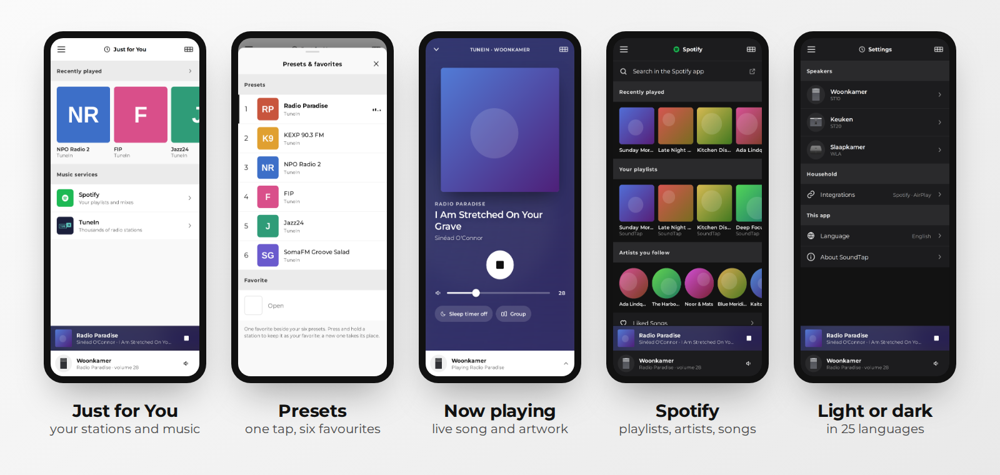
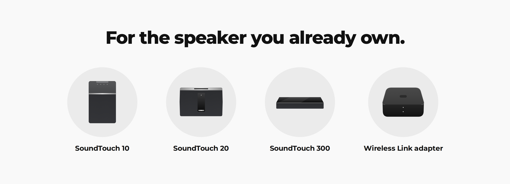

  <picture>
    <source media="(prefers-color-scheme: dark)" srcset="docs/assets/hero-dark.png">
    
  </picture>

  <a href="https://stein155.github.io/soundtap/installer/"><picture><source media="(prefers-color-scheme: dark)" srcset="docs/assets/install-button-dark.svg"></picture></a>

  <a href="docs/owners/install.md">Install guide</a> ·
  <a href="docs/owners/faq.md">FAQ</a> ·
  <a href="docs/owners/compatibility.md">Supported speakers</a> ·
  <a href="CONTRIBUTING.md">Contribute</a>

 

  In May 2026 Bose switched off the SoundTouch cloud. <b>SoundTap gives your speaker a second
  life</b>: new software that runs on the speaker itself, with no Bose software, no cloud and no
  account, and that does more than SoundTouch ever did.

 

  <picture>
    <source media="(prefers-color-scheme: dark)" srcset="docs/assets/features-dark.png">
    
  </picture>

## Everything you had is still there

Your six presets and the buttons on the speaker, the remote, internet radio, Spotify Connect,
the alarm and the sleep timer, the SoundTouch 20's clock, Bluetooth and AUX.

Not every feature has been tested on every model yet, and Bluetooth and AUX are still being
proven: the [compatibility page](docs/owners/compatibility.md) says what has run on which speaker.

  <picture>
    <source media="(prefers-color-scheme: dark)" srcset="docs/assets/screens-dark.png">
    
  </picture>

## Why SoundTap

|  | Bose app today | Cloud replacements | **SoundTap** |
| --- | :---: | :---: | :---: |
| Presets and radio | — | ✓ | ✓ |
| AirPlay 2 and Apple Home | — | — | ✓ |
| Multiroom with other players | — | — | ✓ |
| Needs an extra device running | no | usually | **no** |
| New updates | — | for the server | **for the speaker** |

  <picture>
    <source media="(prefers-color-scheme: dark)" srcset="docs/assets/speakers-dark.png">
    
  </picture>

  Another SoundTouch? See <a href="docs/owners/compatibility.md">every model and what works on each</a>.

## Install in three steps

<table>
  <tr>
    <td valign="top" width="33%"><b>1. Open the <a href="https://stein155.github.io/soundtap/installer/">installer</a></b> On a computer or phone on the same Wi-Fi as the speaker.</td>
    <td valign="top" width="33%"><b>2. Pick your speaker</b> It shows only the steps for your model, in 25 languages.</td>
    <td valign="top" width="33%"><b>3. Open soundtap.local</b> That's it. Updates come from there too.</td>
  </tr>
</table>

The [install guide](docs/owners/install.md) has every route in detail and the way back to
Bose's software.

> [!WARNING]
> SoundTap is **alpha** software. It runs every day on the maintainer's speakers, but its web page has
> no login yet: anyone on your network can control the speaker. Use it on a network you trust.
> What is left before 1.0 is on the [road to 1.0](docs/owners/roadmap.md).

## For developers

One Go program on mainline Linux, with its own bootloader and signed A/B updates. Start with
the [technical design](docs/contributors/design.md); setup, checks and pull requests are in
[CONTRIBUTING.md](CONTRIBUTING.md).

## Thanks and legal

SoundTap stands on [Linux](https://kernel.org), [U-Boot](https://u-boot.org),
[Buildroot](https://buildroot.org), [librespot](https://github.com/librespot-org/librespot),
[shairport-sync](https://github.com/mikebrady/shairport-sync),
[Snapcast](https://github.com/badaix/snapcast), [BlueALSA](https://github.com/arkq/bluez-alsa)
and [Avahi](https://avahi.org), and owes a lot to everyone in the SoundTouch community who
documented these speakers after the cloud went dark.

SoundTap's own code is licensed under the [GNU GPL v3.0](LICENSE); bundled open-source
components keep their own licenses, listed in [NOTICE.md](NOTICE.md). SoundTap is an
independent project, **not affiliated with, endorsed by or sponsored by Bose Corporation**.
*Bose* and *SoundTouch* are trademarks of Bose Corporation, used only to identify the speakers
SoundTap runs on. Installing alternative firmware is at your own risk.
