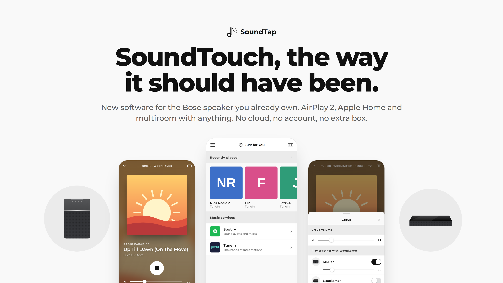

  <picture>
    <source media="(prefers-color-scheme: dark)" srcset="docs/assets/hero-dark.png">
    
  </picture>

  <a href="https://stein155.github.io/soundtap/installer/"><picture><source media="(prefers-color-scheme: dark)" srcset="docs/assets/install-button-dark.svg"></picture></a>

  Run the installer, one line on a computer on the same Wi-Fi, or upload the file on the
  speaker's own update page, from a phone. For the SoundTouch 10, SoundTouch 20 Series I, SoundTouch 300 and
  Wireless Link adapter, and as previews, never run on hardware, most other SoundTouch models (<a href="#supported-speakers">all models</a>), step by step in 25
  languages; the details are in the <a href="docs/owners/install.md">installation guide</a>.

  
  
  
  
  

  <a href="docs/owners/install.md"><b>Install guide</b></a> ·
  <a href="docs/owners/faq.md"><b>FAQ</b></a> ·
  <a href="#how-it-works"><b>How it works</b></a> ·
  <a href="docs/contributors/design.md"><b>Design</b></a> ·
  <a href="CONTRIBUTING.md"><b>Contribute</b></a>

---

Bose ended SoundTouch cloud support on 6 May 2026. Its updated app still controls and groups
speakers locally, but service browsing and supported preset operation are gone, and Bose
provides no further firmware or security updates ([Bose's announcement](https://www.bose.com/soundtouch-end-of-life-row)).

**SoundTap is new software for the speaker you already own.** Not an app, not a server you
have to keep running next to it: a complete operating system built from open source, with
no Bose software in it, from the bootloader to the web page on your phone. Afterwards the speaker runs on its own, on
your home network, and does more than it ever did.

> [!WARNING]
> SoundTap is **alpha** software, version 0.x. It runs every day on our own speakers, but it
> has not yet passed everything a 1.0 needs: for now its web page has no login, so anyone on
> your network can control the speaker. Use it only on a network you trust. What is left is listed on the
> [road to 1.0](docs/owners/roadmap.md).

## Why SoundTap

- **Yours, not a server's.** No SoundTap account, cloud service or tracking. Music services
  remain your choice; the speaker also uses public time servers and GitHub for updates
  ([network contacts](docs/owners/faq.md#does-it-phone-home)).
- **Rebuilt from the ground up.** Our own bootloader, mainline Linux 6.12, our own drivers
  and a player written for SoundTap. Not a patch on top of Bose's software, which is what
  makes everything below possible. ([What "built from scratch" means here.](docs/owners/faq.md#is-it-really-built-from-scratch))
- **More than it ever was.** AirPlay 2, Spotify Connect, multiroom with any Snapcast
  client, your own media server and any MQTT client, controlled from the speaker's own web page.
- **Built not to strand you.** Updates go into a second slot, and the speaker only keeps a
  new version once it has proven itself. Every supported model has a documented way back to
  Bose's software.

## Screenshots

  

The speaker serves this page itself. Open it on any phone, tablet or computer, add it to your
home screen, and it behaves like an app, with no app store and no account involved.

## What you get

| | |
| --- | --- |
| 📻 **Internet radio** | Search and play thousands of TuneIn stations, or add your own stream. SoundTap shows the song that is on and its album art, read from the station's own stream (the song name is not yet confirmed on the SoundTouch 10). |
| 🟢 **Spotify Connect** | The speaker appears in the Spotify app like any Connect speaker. Browse your playlists, albums and liked songs from its own page too. |
| 🍏 **AirPlay 2** | Built to play from iPhone, iPad and Mac, group with HomePods and join the Apple Home app. So far it has played on the Wireless Link from Music Assistant and, by its owner's report, on the SoundTouch 300. An iPhone, HomePods, the Home app and Siri have no recorded run. |
| 🔊 **Multiroom** | Group speakers and play the same music everywhere, in sync, with a volume per room. Any speaker can lead (not yet run as leader on the SoundTouch 300). Built on [Snapcast](https://github.com/badaix/snapcast), so a Raspberry Pi can join too, given the speaker's address. |
| 🎛️ **Six presets** | The buttons on the speaker work again, and so does the remote on the SoundTouch 10 and 20. A preset is a station, a Spotify playlist or something from your media server. |
| 🏠 **MQTT** | Point it at your MQTT broker: power, volume, presets, play/pause and what is playing, for any MQTT client. Compatible hubs find the speaker by themselves. |
| 🗂️ **Your own music** | Browse a NAS or media server (UPnP/DLNA), or push music from apps such as BubbleUPnP and VLC. |
| 😴 **The little things** | Sleep timer, recently played, announcements, a standby clock on the SoundTouch 20's display. |
| 🌍 **25 languages** | A language picker with 25 options, including English, Nederlands, Deutsch, Français, Español and Afrikaans; light and dark themes. |
| 🔄 **Safe updates** | New versions install from the speaker's settings page into a second slot, signed, and are only kept once they have proven themselves. |
| 🔵 **Bluetooth and AUX** | Built for the models that have them, and still unproven work, not finished features. Bluetooth has played on the SoundTouch 10, the Wireless Link and the SoundTouch 300; AUX on the SoundTouch 10, the 20 and the Wireless Link. |

Not every feature is proven on every model. The [hardware checklist](docs/hardware/hardware-test.md#release-checklist-per-model) lists what has run on which speaker and when, and the [compatibility matrix](docs/owners/compatibility.md) says how sure we are of each feature.

## Supported speakers

| Speaker | Status | Notes |
| --- | --- | --- |
| **SoundTouch 10** | ✅ Supported | Front buttons, lights and the remote. |
| **SoundTouch 20 Series I** | ✅ Supported | Display with clock and now playing. Uses our firmware on its separate network processor. No Bluetooth audio. |
| SoundTouch 20 Series II | 🧪 Validation pending | Shares the Series I platform; generation-specific hardware validation is still required. No Bluetooth audio. |
| SoundTouch 20 Series III | 🧪 Preview | Installs from the preview package; never run on hardware. It carries the ST10's module, so it runs as an ST10 with its own sound tuning from its stock firmware. Its display, Wi-Fi lamp and rear Ethernet port are mapped from stock's hardware description, untested. |
| **SoundTouch Wireless Link adapter** | ✅ Supported | Turns any amplifier or active speakers into a SoundTap player. |
| SoundTouch 30 Series I/II | 🧪 Preview | Installs from the preview package; never run on hardware. Stock's hardware description is the ST20 Series I's except for its own codec settings, so it runs as an ST20 with the ST30's own sound tuning, read from its stock firmware. |
| SoundTouch 30 Series III | 🧪 Preview | As the ST20 Series III, with the ST30's own sound tuning. Its Wi-Fi lamp and front panel are mapped from stock's hardware description, untested. |
| SoundTouch Portable | 🧪 Preview | The ST20 Series I's board with a battery. Built to charge by stock's rules, show the level on the display and in the app, and go to standby after 20 idle minutes on battery; worked out from stock, never run. |
| SoundTouch SA-5 | 🧪 Preview | The ST10's module on an amplifier board. Built to follow its controller's state, faults and heat protection as stock does; worked out from stock, never run. |
| Lifestyle 600/650 (SoundTouch module) | ⛔ Not offered | The code carries it as the SoundTouch 300's module and link, but the installers do not offer it: **it has no way back, and stock has no recovery gesture on it either.** Never run on hardware. |
| SoundTouch adapter: SA-4, Stereo JC, Wave SoundTouch, CineMate, Lifestyle 135–535, VideoWave | 🧪 Preview | Built to drive the host product over the Bose link: select the adapter, hand the volume over and take the Wave's and CineMate's remote keys. Both the older and the Bluetooth adapter, but on a Lifestyle the installers offer only the older one. Worked out from stock, never run. |
| **SoundTouch 300** | ✅ Supported | The soundbar: radio, Spotify, the TV and HDMI inputs, volume and mute, from the app and its remote. The soundbar's own processor keeps driving the bass module, rear speakers and HDMI. It gets SoundTap's own bootloader, like every model ([notes](docs/owners/install.md#soundtouch-300)). |

"Supported" means the model is part of the first release: a release is published only after it has passed that model's [hardware checklist](docs/hardware/hardware-test.md#release-checklist-per-model). No candidate has passed it yet; the alphas published so far are prereleases that come before that test. Individual features may not have run on every model yet. "Validation pending" models install from the same file and "Preview" models from the release's preview package (`SoundTap-Core-X.Y.Z-preview.stu`), but neither has had that test. A preview is worked out from Bose's own software alone ([ADR 0133](docs/decisions/0133-more-soundtouch-models-from-stock.md)) and has never run on hardware, its recovery gesture included; the installers offer one only when you pick it by name and confirm it as a preview, and refuse the Lifestyle 600/650 module, and with it a Lifestyle's Bluetooth adapter, which they cannot tell apart from it.

**One universal file serves the supported models**; each speaker picks its own parts from it.
The model-support roadmap prioritizes
the four supported models, followed by the ST30 generations. Shared stock firmware and offline tests
help prepare a port, but do not establish hardware support for an untested generation or revision.
Have another model? [Help bring it up](https://github.com/stein155/soundtap/issues/new?template=device.yml):
the first step is read-only investigation.

## Getting started

1. **Install.** Open the [installer](https://stein155.github.io/soundtap/installer/): it walks
   you through the install one screen at a time, in the same 25 languages as the speaker's own
   page. With the speaker on your
   Wi-Fi, one line in Terminal or PowerShell finds every speaker that still runs Bose's
   software and installs the ones you pick; the speaker downloads SoundTap itself. Without
   internet, you put the speaker in setup mode and upload the `.stu` from the
   [newest release](https://github.com/stein155/soundtap/releases) on Bose's own update
   page. Only needed once. The [installation guide](docs/owners/install.md) has the same steps in more
   detail, a USB route and troubleshooting.
2. **Connect.** If the stock Wi-Fi profile was imported, the speaker rejoins your home
   network. Otherwise join its setup network and choose your Wi-Fi. Open **http://soundtap.local**.

Everything after that, including updates, happens from the speaker's own page.

> [!NOTE]
> SoundTap Core 0.1.0 is out as an **alpha**, a prerelease signed like a release. The release
> 0.1.0 follows once it has passed the hardware test on the ST10, ST20, Wireless Link and
> SoundTouch 300.

## How it works

One Go daemon, `soundtapd`, is the speaker: it owns the audio path, the presets, the buttons
and lights, the web page and the updates, on mainline Linux with our own bootloader. Every
update goes into the slot that is not running, and the speaker keeps it only after the new
version has stayed up for a minute. There are two version numbers: *SoundTap Core* is
everything that boots, delivered as the `.stu` file and changed rarely; *SoundTap app* is the
player and the page, and updates on its own. The settings page shows both, for example
*SoundTap Core 0.1.0 · app 0.1.0*.

The diagrams and every choice behind this are in the [technical design](docs/contributors/design.md).

## Compared with the alternatives

|  | Bose software today | Cloud emulators | **SoundTap** |
| --- | :---: | :---: | :---: |
| Presets and radio | ❌ | ✅ | ✅ |
| Spotify Connect | ✅ | ✅ | ✅ |
| AirPlay 2 | ⚠️ AirPlay 1, some models | ⚠️ as before | ✅ |
| Multiroom with other devices | ❌ | ❌ | ✅ Snapcast |
| MQTT | via integrations | via integrations | ✅ built in |
| Extra device in your home | none | usually, always on | **none** |
| Bose's software on the speaker | yes | yes | **no** ¹ |
| Future updates | ❌ | from the project | ✅ signed, A/B |

¹ The ST20 network processor runs our app and WiLD core; its original BFL/BSL loaders stay
for recovery. ST10/ST20 also retain their own stock codec tuning. These on-device exceptions
are recorded in [ADR 0049](docs/decisions/0049-no-stock-bytes.md).

Cloud emulators are a good choice if you want to keep Bose's software and change as little
as possible; several community projects do this well. SoundTap is for people who would rather
have the speaker stand on its own.

## For developers

Start with the [technical design](docs/contributors/design.md); it links to everything else. Setup without
a speaker, checks and pull requests are in [CONTRIBUTING.md](CONTRIBUTING.md), and
[its contract](CONTRIBUTING.md#the-contract) holds the rules for anything that touches real
hardware. The HTTP API
has a browsable reference on every speaker, offline: `http://<speaker>/api/docs`.

## Thanks

SoundTap stands on the shoulders of [Linux](https://kernel.org), [U-Boot](https://u-boot.org),
[Buildroot](https://buildroot.org), [librespot](https://github.com/librespot-org/librespot),
[shairport-sync](https://github.com/mikebrady/shairport-sync),
[Snapcast](https://github.com/badaix/snapcast), [BlueALSA](https://github.com/arkq/bluez-alsa)
and [Avahi](https://avahi.org), and owes a lot to everyone in the SoundTouch community who
documented these speakers after the cloud went dark.

## Legal

SoundTap's own code is licensed under the [GNU GPL v3.0](LICENSE); bundled open-source components keep their
own licenses, listed in [NOTICE.md](NOTICE.md).

SoundTap is an independent project, **not affiliated with, endorsed by or sponsored by Bose
Corporation**. *Bose* and *SoundTouch* are trademarks of Bose Corporation, used only to
identify the speakers SoundTap runs on. Installing alternative firmware is at your own risk.

The tree and its history hold no stock firmware; reference inputs stay outside git
([ADR 0049](docs/decisions/0049-no-stock-bytes.md)). See [NOTICE.md](NOTICE.md).
