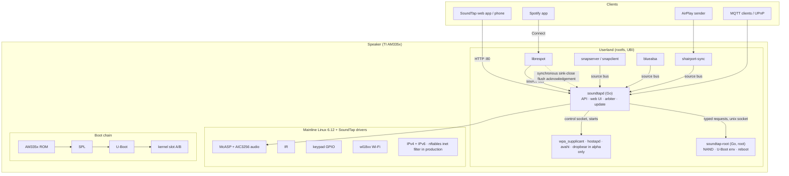
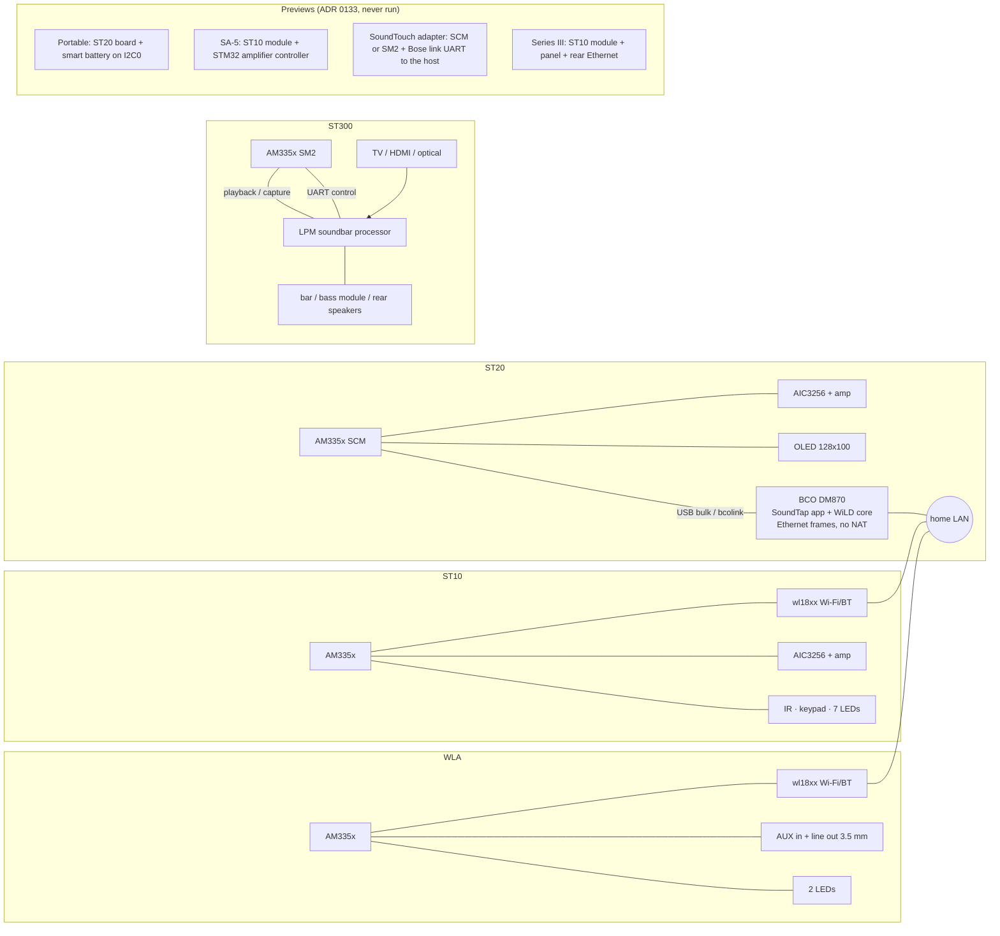
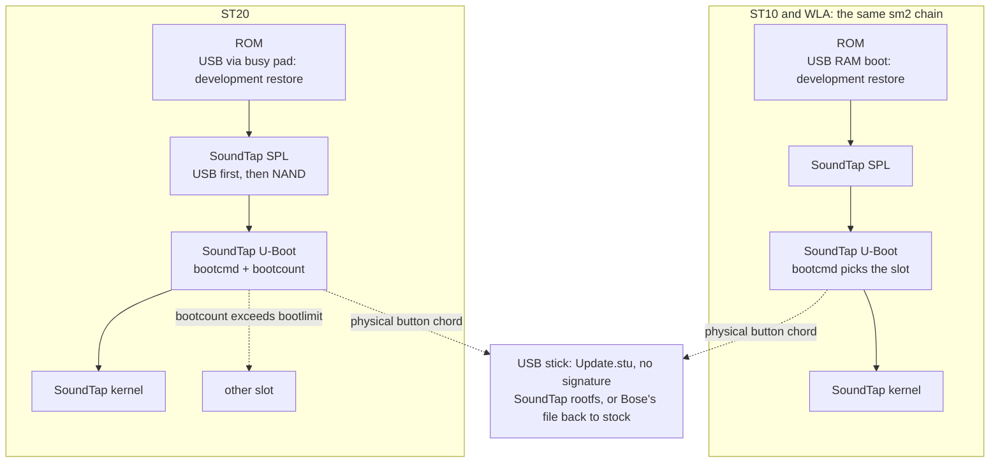
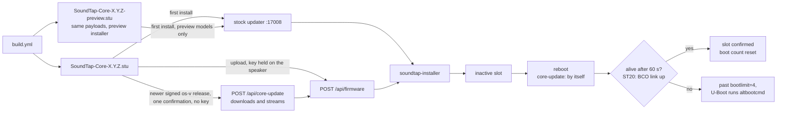
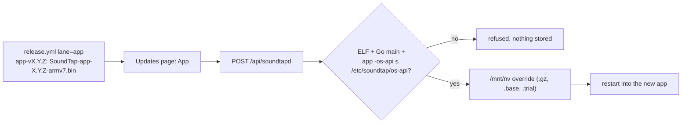
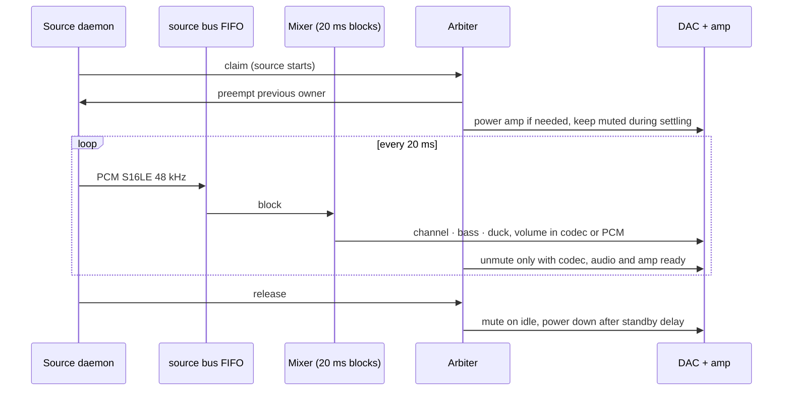
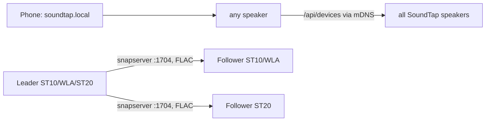
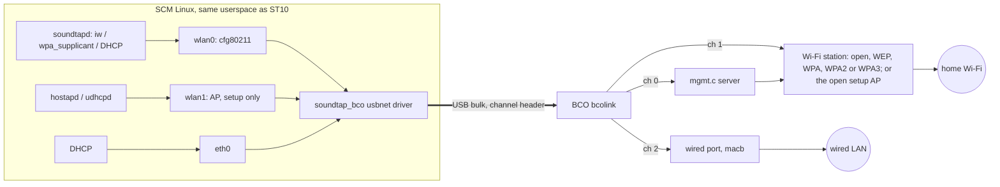

# SoundTap technical design

Status: living document, first version 2026-09-30. It describes the system as it is on `main`.
Each architectural choice links to its ADR in [`decisions/`](../decisions/README.md). Change a
choice by updating its ADR (or adding one for a new subject), then update this document
in the same PR.

Everything for contributors starts here:

| Topic | Where |
| --- | --- |
| Setup, checks, pull requests | [CONTRIBUTING.md](../../CONTRIBUTING.md) |
| Hardware safety rules | [the contract](../../CONTRIBUTING.md#the-contract) |
| Why each choice was made | [decision records](../decisions/README.md) |
| What "Bose-free" means | [ADR 0049](../decisions/0049-no-stock-bytes.md) |
| The Buildroot tree | [os/README.md](../../os/README.md) |
| Releasing and hardware approval | [RELEASING.md](../../RELEASING.md), [hardware-test.md](../hardware/hardware-test.md) |
| What is tested where | [test map](testing/README.md), [install gate](testing/install-gate.md) |
| State on the speaker, environment variables | [nv-state.md](nv-state.md), [environment.md](environment.md) |
| Per-model notes (how stock does it) | [ST10](../hardware/st10/README.md), [ST20](../hardware/st20/README.md), [Wireless Link](../hardware/wla/README.md), [ST300](../hardware/st300/README.md) |

## 1. Goal and scope

SoundTap replaces the discontinued Bose SoundTouch software stack with firmware built
from source: bootloader, mainline Linux, drivers, userland, update path and app. Bose-free
has one definition: [ADR 0049](../decisions/0049-no-stock-bytes.md).

| Model | Stock variant | Implemented chain |
|---|---|---|
| SoundTouch 10 (ST10) | `rhino` / sm2 | fully SoundTap incl. SPL/U-Boot |
| Wireless Link Adapter (WLA) | `binky` / sm2 | fully SoundTap incl. SPL/U-Boot |
| SoundTouch 20 (ST20) | `spotty` / scm | fully SoundTap incl. SPL/U-Boot; BCO runs SoundTap's app and WiLD core (its BFL/BSL stay stock) |
| SoundTouch 300 | `ginger` / sm2 | fully SoundTap incl. SPL/U-Boot; the soundbar processor (LPM) keeps its own firmware and drives the bass module, rears and HDMI |

Previews ([ADR 0133](../decisions/0133-more-soundtouch-models-from-stock.md)), worked out from the
stock packages alone and never run on hardware. The installers offer them only after an
explicit preview confirmation, and their recovery gestures are implemented, not proven:

| Model | Stock variant | Runs as |
|---|---|---|
| SoundTouch 30 Series I/II | `mojo` / scm | the ST20 |
| SoundTouch 20/30 Series III | `spotty3`, `mojo3` (stock `spotty`, `mojo`) / sm2 | the ST10, with its panel and rear Ethernet port |
| SoundTouch Portable | `taigan` / scm | the ST20, with its smart battery (`hw/battery`) |
| SoundTouch SA-5 | `burns` / sm2 | the ST10, with its amplifier controller (`hw/stm32amp`) |
| SoundTouch adapter (SA-4, Stereo JC, Wave, CineMate, Lifestyle, VideoWave) | `lisa` / scm, `lisa2` / sm2 | the ST20 or the ST10, master of the Bose link to the host (`abl`); the installers refuse an sm2 Lifestyle, so on a Lifestyle only `lisa` is offered |
| Lifestyle 600/650 module | `bardeen` / sm2 | the ST300; in the code, refused by the installers and the STU installer (no way back) |

What tells the models apart (variant, module type, the modules and boot chain each takes, the
device tree, kernel and codec script each boots) is one table, `os/models.json`
([ADR 0008](../decisions/0008-one-universal-stu.md)); soundtapd's copy is generated from it and
every other copy is tested against it.

This table describes the implementation, not release approval. Per-model observations and
missing runs are in the [compatibility matrix](../owners/compatibility.md); exact-candidate gates are
in the [hardware checklist](../hardware/hardware-test.md).

Out of scope: a HomeKit bridge, Google Cast and Sonos
([ADR 0003](../decisions/0003-apple-home-via-airplay-no-cast-no-sonos.md)), and Sendspin.

The documented HTTP API becomes stable with the first public release, 0.1.0 (decided
2026-11-13), under the API-level and deprecation rules of
[ADR 0108](../decisions/0108-http-api-compatibility-for-1-0.md). Alpha builds before that
release could still change it; the promise starts at 0.1.0, not at 1.0.

### Stock behaviour is the baseline

Where stock had a feature, SoundTap behaves as stock does, and that needs no ADR
([decision records](../decisions/README.md)). Kept as on stock: bass per model; Wi-Fi sources
attenuated against AUX; holding AUX switches to Bluetooth; Bluetooth selected with nothing paired;
volume keys in a group; volume steps without a glide; start in standby after a power cut; a factory
reset clears user settings and credentials and keeps the speaker's codec calibration and
manufacturing data ([ADR 0012](../decisions/0012-single-dac-writer.md)). Different from stock on
purpose: Snapcast multiroom instead of Bose zones, the ST20 standby clock,
every extra (alarm, sleep timer, notifications, MQTT), WPA3 and protected management frames
([ADR 0136](../decisions/0136-every-network-stock-joined-and-wpa3.md)), updates started only by hand, no low-power
standby on a long POWER hold, the Volume down + preset chords only for presets 1 and 2, and no
stock `:8090` API.

## 2. System layers



- **soundtapd** is the one daemon ([ADR 0001](../decisions/0001-soundtapd-one-go-daemon.md)). Packages under `app/internal/`:
  `audio` (mixer and arbiter), `speakerstate` (Bose-compatible speaker model), `web` (API and
  UI), `stu`, `install`, `flash` and `update` (packages and install), `bco` (the ST20 network card), `spotify`, `snapcast`, `upnp`,
  `mdns` (avahi over D-Bus, [ADR 0043](../decisions/0043-mdns-through-avahi.md)), `mqtt` (Eclipse
  Paho's client, [ADR 0110](../decisions/0110-mqtt-bridge.md)), `mqttbridge`, `display`, `bluez`
  (the pairing agent) and `btctl` over `sysbus` (D-Bus through godbus,
  [ADR 0114](../decisions/0114-bluetooth-agent-in-soundtapd.md)), `tunein`, `radiobrowser` (the
  station lookup for stock's Radio Browser presets, [ADR 0129](../decisions/0129-first-install-keeps-settings.md)), `hw` (keypad, remote, lamps,
  amplifier lines and the hardware watchdog behind small interfaces) with `hw/model` (the
  hardware profile per model), `modeltable` (the model table, generated from `os/models.json`), `player` (radio and UPnP through ffmpeg), `panel` (the ST20 panel), `lpm` (the ST300's
  soundbar processor, [ADR 0109](../decisions/0109-st300-soundbar-processor-link.md)), `hw/battery` (the Portable's
  smart battery: gauge, charger and stock's SHIP rules), `hw/stm32amp` (the SA-5's amplifier
  controller), `abl` (the Bose link master for the SoundTouch adapter, [ADR 0133](../decisions/0133-more-soundtouch-models-from-stock.md)), `supervise`
  (the media daemons' supervisor), `counters` (the counts `/api/health` reports,
  [ADR 0127](../decisions/0127-health-counters-and-alpha-pprof.md)), `lanfilter` (keeps the production filter's IPv6 own-prefix set `lan_nets6`, [ADR 0134](../decisions/0134-ipv6-on-the-speaker.md)) and `wifi` (the Wi-Fi manager: the
  station join over wpa_supplicant's control socket through `wpactrl`, the fallback to the last
  network that worked and the hostapd setup AP, [ADR 0063](../decisions/0063-wifi-lease-and-setup-ap.md)). `app/cmd/soundtapd` keeps what wires them together per model:
  the button handler, the arbiter's wiring and the source ownership, the media daemons' table,
  identity, network and setup, and the web server's options (`web.New(web.Options)`,
  [ADR 0091](../decisions/0091-web-api-split-into-lanes.md)). Go modules are vendored in `app/vendor/` and build offline in Buildroot
  ([ADR 0124](../decisions/0124-third-party-code.md), [ADR 0011](../decisions/0011-one-buildroot-pipeline.md)).
- **Spotify track boundaries**: upstream `--disable-gapless` closes and drains the source
  before the sink hook asks the mixer to discard old PCM and acknowledge it. Natural ends
  keep their tail; gapless albums are not guaranteed. See [ADR 0014](../decisions/0014-spotify-through-librespot.md).
- **Supervision**: one supervisor per process ([ADR 0121](../decisions/0121-one-supervisor-per-process.md)).
  `/etc/init.d/soundtap` restarts soundtapd under `soundtapd_loop` and soundtap-root under a
  loop of its own; soundtapd restarts the media daemons under one bounded rule, `restartPolicy` (`app/internal/supervise`). The network
  daemons (wpa_supplicant, udhcpc, hostapd, udhcpd, dnsd) are started by the Wi-Fi manager and
  outlive a soundtapd restart: the next soundtapd keeps a joined station or a running setup AP
  ([ADR 0063](../decisions/0063-wifi-lease-and-setup-ap.md)).
- **Persistent state** lives in `/mnt/nv` (UBI volume on `mtd10`), and nothing else is
  writable across reboots.

## 3. Hardware per model



Under the stock BCO app the ST20's main CPU sits behind NAT with selected inbound ports
and no multicast forwarding, so SoundTap does not support that firmware. SoundTap's own BCO app puts it
on the LAN with its own `wlan0` address, and SoundTap serves `:80` there as everywhere (§12,
[ADR 0001](../decisions/0001-soundtapd-one-go-daemon.md)). All four models share one NAND layout:

| mtd | Content | Written by an update? |
|---|---|---|
| 0-3 | SPL copies | when they differ from the package, or match only after many ECC corrections (ADR 0008) |
| 4 | U-Boot, its spare, and in the last block the redundant environment copy | the U-Boot copies when they differ from the package, or match only after many ECC corrections |
| 5 | U-Boot environment, primary copy | slot selection, boot recipes and fallback state through `fw_setenv`, one copy at a time (ADR 0010) |
| 6 / 7 | kernel Ping / Pong | the inactive one |
| 8 / 9 | rootfs Ping / Pong (UBI) | the inactive one |
| 10 | `/mnt/nv` persistent | never |
| 11 | update staging | never by SoundTap |
| 12 | manufacturing data | never |

## 4. Boot



The ST10, ST20 and Wireless Link run SoundTap's SPL, U-Boot, kernel and rootfs since 2026-09-30
([ADR 0009](../decisions/0009-mainline-linux-own-bootloaders.md)), the ST300 since its first install
(2026-11-15). SoundTap's U-Boot implements
USB-stick recovery with Vol- + Preset 4 (ST10/ST20) or both buttons (WLA). The ST300 starts it
with its remote's combo, passed on by the soundbar processor. Holding the keys is the
authorization: no signature is read ([ADR 0130](../decisions/0130-usb-stick-recovery.md)).
`Update.stu` must check out CRC for CRC and is hashed before anything is erased and again
while it is written. A SoundTap package writes the SoundTap rootfs, including `/boot`,
without replacing bootloaders; Bose's own file for the board goes back to stock, its SPL and
U-Boot included. This implementation
still needs exact-candidate, per-model recovery validation. Below a damaged boot chain,
ROM-USB plus the board's verified NAND backup is the development restore route
(`tools/recovery/rom-usb-restore.py`, ADR 0009): it writes the release's SPL and U-Boot in the
installer's order and can put back partitions from that backup.

The AM335x watchdog is enabled early. Linux feeds it for at most the configured 180 s
userspace-open window. soundtapd then requests a 120 s timeout and checks its own listener
and mixer progress every 10 s; three consecutive failures stop feeding. Device-open or
timeout-setup failure is logged and does not establish this guarantee. The daemon never
uses magic-close to disarm it, and a kernel oops panics and resets the board rather than
leaving a half-dead kernel to be fed ([ADR 0052](../decisions/0052-soundtapd-lifecycle.md)).
Nothing of that timeout crosses a reboot: the kernel's `omap_wdt` shutdown hook stops the
watchdog before the reset, and SoundTap's SPL reloads it for 120 s (nominal, from the internal RC
oscillator) before anything else. U-Boot does not feed it, so SPL, U-Boot and the kernel
share that one window until `omap_wdt` takes over, and a hang in any of them resets into
U-Boot's boot count.

On the ST20 SoundTap's U-Boot also switches on the OLED's VDD3 supply and paints soundtapd's first boot frame, so the panel shows a picture about a second after power-on ([ADR 0131](../decisions/0131-st20-boot-frame.md)).

Details: [ADR 0009](../decisions/0009-mainline-linux-own-bootloaders.md),
[`st20/rom-usb-recovery.md`](../hardware/st20/rom-usb-recovery.md).

## 5. Install and update

One file for every model ([ADR 0008](../decisions/0008-one-universal-stu.md)), with two routes
into the speaker:



A/B rules and the confirm sequence: [ADR 0010](../decisions/0010-ab-slots-boot-confirm-rollback.md).
A preview model installs only from the preview package, which differs from the main one in its
installer (module 0) alone and has its own `.sig` and feed ([ADR 0133](../decisions/0133-more-soundtouch-models-from-stock.md)).
"Alive" means soundtapd has run a minute and its API answers on loopback; on the ST20 also
that its BCO install step is over and SoundTap's BCO app's link (`bcolink0`) is up. The network is
never checked, so a speaker on a broken LAN keeps a good image. On every model,
init reboots a NAND boot whose soundtapd never comes up within 300 s. U-Boot's boot count
(RTC SCRATCH2, and for an unconfirmed slot the environment, which a power cut does not
clear) then carries it to the other slot ([ADR 0010](../decisions/0010-ab-slots-boot-confirm-rollback.md)).
A first install from Bose's software keeps the speaker's name, TuneIn and Radio Browser presets
(the latter looked up by uuid at radio-browser.info once the network is up) and Wi-Fi: the
installer takes the key for ST10/WLA stock's encrypted `NetworkProfiles.xml` from NetManager,
and soundtapd turns every saved profile into `wifi.conf` and `wifi.conf.known` on first boot. On the ST20 it reads the
stock BCO app's settings log before replacing that app, and holds the BCO install until that
read gave an answer or ran out of tries ([ADR 0008](../decisions/0008-one-universal-stu.md),
[ADR 0129](../decisions/0129-first-install-keeps-settings.md)).
Operator steps per model: [the install guide](../owners/install.md).
The SoundTap app (soundtapd with the UI) also has its own lane ([ADR 0035](../decisions/0035-releases.md)):



The override survives restarts and reboots while its recorded Core base still matches.
A failed trial, repeated failures, a changed base or `DELETE /api/soundtapd` returns to the
bundled app ([ADR 0052](../decisions/0052-soundtapd-lifecycle.md)). `internal/osapi/level` is the
contract: the OS installs it as `/etc/soundtap/os-api`, the app embeds it. Raise it in any commit that
changes something the app relies on in the OS.

Both lanes find their releases on GitHub, over TLS, and so only once NTP has set the clock
since boot: before that the check answers "clock not set" (`clock_not_set`) instead of asking.
The time comes from the DHCP lease's NTP servers, then the owner's list or Cloudflare's and
Google's public services, never the NTP Pool's default zone
([ADR 0125](../decisions/0125-time-sources-and-clock-gating.md)).

## 6. Audio

Sources rendered on the AM335x go into one bus, with soundtapd owning the physical output
([ADR 0012](../decisions/0012-single-dac-writer.md)). On the ST300, TV/HDMI audio stays in the
soundbar processor. When it leads a group, `tv_share.go` captures the processor's return
into the Snapcast tap; the local bar is not delayed to match followers
([ADR 0116](../decisions/0116-st300-tv-input-share.md)).



Volume uses the stock dB curve: codec DSP gain on the ST10/ST20, PCM gain where no codec
volume control exists ([ADR 0012](../decisions/0012-single-dac-writer.md)). ST10/ST20 bass
uses a 260 Hz first-order shelf, -9..0 at 1.22 dB per step, after the multiroom tap.
This implements the stock ST20 PCM measurement;
the earlier static-analysis claim that bass did nothing was wrong. The Wireless Link has no
bass control. Amp power sequencing waits three seconds when bringing an amp out of standby;
unmute also depends on codec readiness and flowing audio (`audio_owner.go`).
Announcements duck the bus.

## 7. Sources and integrations

| Source / integration | Component | Notes |
|---|---|---|
| Spotify Connect + browse | librespot + control API on loopback | [ADR 0014](../decisions/0014-spotify-through-librespot.md) |
| AirPlay 2 | shairport-sync + nqptp | Apple Home through AirPlay ([ADR 0003](../decisions/0003-apple-home-via-airplay-no-cast-no-sonos.md)); ST20: SoundTap's BCO app forwards multicast; discovery needs model-specific validation |
| TuneIn / internet radio | soundtapd + SoundTap's shared ffmpeg package (ADR 0041) | presets 1-6 |
| UPnP/DLNA renderer | soundtapd `upnp` | |
| Bluetooth | bluealsa | ST10/WLA pairing and silent-stream evidence; phone checks remain open; not on ST20 gen 1 ([checklist](../hardware/hardware-test.md#open-hardware-checks)) |
| Multiroom | Snapcast | [ADR 0013](../decisions/0013-multiroom-through-snapcast.md) |
| MQTT | soundtapd `mqttbridge` (discovery, transport buttons, update entity) | off until the settings page enables it; ST20: broker must be reachable through BCO |

## 8. Multiroom and discovery



There is no permanent master. Relations carry a reachable address and, when known, a device
ID to verify the peer; addresses can change through discovery. Stereo pairs are groups with
a channel selected per speaker ([ADR 0107](../decisions/0107-stereo-pair-acts-as-one-speaker.md)).

Every speaker runs snapserver; a snapclient runs only on a follower whose source is
MULTIROOM and, as a muted anchor holding the group, on a leader while it has or is about
to have followers and for a minute after. An idle speaker in standby runs none
([ADR 0013](../decisions/0013-multiroom-through-snapcast.md)). The stream between speakers
is lossless FLAC (level 1, 48 kHz 16-bit stereo), not PCM: the leader encodes once, every
snapclient decodes, and a follower on a Core without FLAC cannot follow.

Snapcast lines up the clients' outputs; what comes after that differs per speaker. Each
speaker measures its own chain (bus FIFO, Mixer queue, aplay's pipe, ALSA ring). A
follower reports it at `GET /api/multiroom/downstream`, and the leader sets it as that
client's Snapcast latency and delays its own output to match
([ADR 0013](../decisions/0013-multiroom-through-snapcast.md)).

Anything that has to happen later or for the whole house runs on each speaker, not in
the page ([ADR 0029](../decisions/0029-speaker-side-timers-and-household-prefs.md)): the
sleep timer (`/api/sleep`), the alarm and the group preferences (`alarm` and `multiroom`
in `/api/settings`), and the power switch (`/api/power`). A leader with `syncVolume`
steps its followers' volume when a `POST /api/volume` carries `"group": true` (the group
slider; a per-room slider does not forward); without `keepGroups` it releases them on
every standby, whatever caused it. A stereo pair keeps its follower and synchronises group
volume regardless of those preferences ([ADR 0107](../decisions/0107-stereo-pair-acts-as-one-speaker.md)).
Every standby also cancels the sleep timer.

### Diagnostics

`GET /api/debug` is the support bundle: redacted plain text, or with `?download=1` the zip
the UI's *Support bundle* button saves, with every log in full and the previous boot's ramoops
records, all through one redactor ([ADR 0055](../decisions/0055-household-token-and-windows.md)).
With the owner's opt-in, `GET /api/crash-report` writes up soundtapd's last panic, a kernel crash
of the previous boot or a media daemon's crash loop through the same redactor, as a GitHub issue
link the owner reads in the web UI and submits from their own browser; there is no server
([ADR 0126](../decisions/0126-opt-in-crash-reports-without-a-server.md)).
`GET /api/health` carries `counters`, kept in memory by `app/internal/counters`: soundtapd's
restarts in this boot, each media daemon's restarts, buffer and ALSA underruns, failed installs
and BCO flashes, and boot confirmation retries. An alpha image also serves Go's profiler on
`127.0.0.1:6060`, reached over its SSH ([ADR 0127](../decisions/0127-health-counters-and-alpha-pprof.md)).

## 9. Build and release

```mermaid
flowchart LR
  PR[PR and main] --> LINT[build-stu.yml CI: lint, Go, Go -race, frontend, Python, firewall, BCO, vulnerabilities<br/>OS build when a PR touches os/ or bco/]
  main --> MS[build.yml: make os<br/>toolchain · kernel · bootloaders · rootfs · STU<br/>artifact candidate · install gate per model]
  main --> CB[build.yml profile=production<br/>fresh output, downloads + ccache]
  main --> REPRO[reproducible.yml weekly: make repro-check<br/>two clean builds, same SHA256SUMS and STU]
  CB --> HW[hardware test on ST10, WLA, ST20, ST300]
  HW --> REL[release.yml lane=os: tag os-vX.Y.Z, draft exact bytes]
  HW --> REP["hardware reports PR: releases/os-vX.Y.Z/"]
  CB -. alpha X.Y.Z-alpha.N: no hardware reports, a prerelease .-> REL
  main --> APP[release.yml lane=app: tag app-vX.Y.Z, draft soundtapd + UI]
  REL & APP --> SIGN[sign.yml in the release environment, main only:<br/>release key secret, still a draft]
  REP -. a Core release X.Y.Z: the four reports on main .-> SIGN
  SIGN --> OWN[maintainer's bench speakers: signed upload]
  OWN --> PUB[sign.yml publish=true; Core: update feeds PR]
  LINT -. must have passed on the commit .-> REL
  LINT -. must have passed on the commit .-> APP
```

- Every workflow runs on GitHub-hosted runners and calls the repository's own entry points, `tools/ci/run-ci.sh` and `tools/ci/run-build.sh`, which a developer's own build machine runs too ([ADR 0011](../decisions/0011-one-buildroot-pipeline.md)).
- Only `sign.yml` reads the release key: an encrypted secret of the GitHub Actions environment `release`, whose deployment branches are `main` alone. `release.yml` makes drafts without it and has `sign.yml` sign an alpha's at once; a Core release is signed against its four hardware reports in `releases/os-vX.Y.Z/` ([ADR 0035](../decisions/0035-releases.md)).
- Speakers trust two compiled release keys, the active one and a reserve, in soundtapd; the USB stick at power-on checks no signature ([ADR 0130](../decisions/0130-usb-stick-recovery.md)). Only a signed release the speaker fetches itself installs without anyone at the speaker, in one tap on the Updates page; every upload, signed or not, waits for the hold on the speaker, and an own build or any other `.stu` installs unsigned that way on any profile. The first-install feed `updates/soundtouch` and the preview models' `updates/soundtouch-preview` are held to a signed release by code-owner review and `feed.yml` ([ADR 0048](../decisions/0048-signed-updates.md), [ADR 0133](../decisions/0133-more-soundtouch-models-from-stock.md), [RELEASING.md](../../RELEASING.md#the-first-install-feed)).
- One pipeline: Buildroot, one profile `os/configs/soundtap_defconfig` ([ADR 0011](../decisions/0011-one-buildroot-pipeline.md)). `make os` builds it, `make stu` packages it with
  `os/installer/build-universal-stu.sh`. Neither the repository nor the STU holds Bose files
  ([ADR 0049](../decisions/0049-no-stock-bytes.md)).
- Repository layout: `app/` (the app), `os/` (the OS and Buildroot external tree, with its
  build checkers in `os/support/` and its shell, build and docs tests in `os/tests/`), `bco/`
  (the ST20 network processor), `docs/`, and `tools/` (CI, release, bench and recovery
  tooling; nothing that ships)
  ([ADR 0040](../decisions/0040-repository-layout.md)).
- Buildroot builds the musl toolchain once per key (`soundtap_toolchain_defconfig`), keeps it
  under `.cache/toolchain/`, and uses it as an external toolchain. CI keeps no storage
  release: build outputs are artifacts of their run, rebuilt once expired, and `release.yml`
  takes the `candidate` artifact of the Build run on its commit
  ([ADR 0011](../decisions/0011-one-buildroot-pipeline.md)).
- The OS lane publishes only a production-profile candidate from a fresh hosted Buildroot output
  tree, with downloads and compiler cache restored; pushes to `main`
  build an alpha candidate with the same fresh-output policy ([ADR 0035](../decisions/0035-releases.md)).
- Both release lanes publish only a commit CI passed on ([ADR 0035](../decisions/0035-releases.md)).
- A build is reproducible: the same commit and `SOURCE_DATE_EPOCH` give the same images and STU,
  so anyone can check a release against its source. The kernel signs no modules for that reason;
  init closes module loading after boot instead. `reproducible.yml` builds twice and compares
  ([ADR 0011](../decisions/0011-one-buildroot-pipeline.md), [ADR 0048](../decisions/0048-signed-updates.md)).
- Releases are named **SoundTap Core X.Y.Z** and **SoundTap app X.Y.Z**; the numbers come from `os/VERSION`
  and `app/VERSION`, and every image reports both through `/api/version`
  ([ADR 0035](../decisions/0035-releases.md)). A version `X.Y.Z-alpha.N` is an alpha: a production
  build published as a GitHub prerelease and signed without the per-model hardware reports. Only a
  speaker that runs an alpha is offered one; it moves on to newer alphas and to the release.
- `install.sh`, `install.ps1` and the browser installer admit a stock speaker by one table,
  `docs/installer/versions.json`: the supported models, the previews and the models not
  supported yet, whatever their Bose software version
  ([ADR 0008](../decisions/0008-one-universal-stu.md)).
- The browser installer verifies first boot with a readable `GET /api/version` response.
  This build-metadata route alone permits credential-free cross-origin reads; an opaque
  answer on port 80 never establishes success ([ADR 0113](../decisions/0113-threat-model.md)).
- Release rules: [RELEASING.md](../../RELEASING.md) and the [hardware checklist](../hardware/hardware-test.md).

## 10. Security

- Two release profiles, chosen with `make SOUNDTAP_PROFILE=alpha|production os`
  ([ADR 0011](../decisions/0011-one-buildroot-pipeline.md)). Alpha (the default) has root SSH
  without a password and a root shell on the USB gadget for bring-up. Production has neither, and root
  cannot log in; nothing replaces SSH there ([ADR 0119](../decisions/0119-no-ssh-in-production.md)). The image names its profile in `/etc/soundtap/profile`, and `make os` checks it.
  soundtapd serves Go's profiler on loopback only when that file says alpha
  ([ADR 0127](../decisions/0127-health-counters-and-alpha-pprof.md)).
- soundtapd runs as its own user `soundtapd` with six capabilities (`CAP_NET_BIND_SERVICE`,
  `CAP_NET_ADMIN`, `CAP_NET_RAW`, `CAP_SETUID`, `CAP_SETGID`, `CAP_KILL`), started by
  `soundtap-root exec-soundtapd`. NAND and environment writes, reboot, U-Boot's boot count, the
  BCO's supply, the host name, GPIO exports, the clock sync, bt-ctl.sh and the factory reset of
  other users' state go to the root helper `soundtap-root` as typed requests it checks against
  the NAND contract (`app/internal/rootd`). The media daemons run as users of their own and get
  no capability unless they need one ([ADR 0066](../decisions/0066-production-hardening.md)).
- The speaker runs IPv6 next to IPv4: link-local and SLAAC addresses, temporary addresses for
  connections out; IPv4 stays its address for the API, mDNS peers, UPnP and multiroom. A production
  image filters both in one nftables `inet` table that answers only the speaker's own subnets and
  prefixes (`lan_nets` from `lan-allow.sh`, `lan_nets6` from soundtapd's `lanfilter`)
  ([ADR 0066](../decisions/0066-production-hardening.md), [ADR 0134](../decisions/0134-ipv6-on-the-speaker.md)).
- Credentials (Wi-Fi, Spotify) stay on the speaker in `/mnt/nv`, with mode 0600. They never go
  to the browser, logs or diagnostics.
- Bootloader writes follow the permission gates of [the contract](../../CONTRIBUTING.md#absolute-safety-rules) and need a proven recovery plan,
  including the board's NAND backup and ROM-USB restore path on every model; only the first
  install from Bose's software runs without a backup. The firmware API
  writes shared bootloaders when their bytes differ; A/B protects kernel/rootfs slots only.
- Under SoundTap the BCO runs SoundTap's app; going back to stock restores stock's BCO app
  separately, with the `bcoflash` development tool. The BFL/BSL loaders stay as they are:
  updating the app through them is allowed, replacing them is not. Never use BSL flashing
  tools, raw BCO memory writes or guessed commands (ADR 0031).
- Stock files stay outside git. The public repository starts from one clean commit of the
  tree (ADR 0049), so its history holds no Bose bytes either.

## 11. Open points to steer on

The boot chain, rollback, production profile, Buildroot pipeline and own BCO app are
accepted decisions, documented in the sections above. They are not open architecture items.
Remaining hardware validation is tracked in [hardware-test.md](../hardware/hardware-test.md) and
[roadmap.md](../owners/roadmap.md).

Per-source gain is implemented in `internal/hw/model` / the Mixer, but still needs
model-specific level assessment. ST10/ST20 use 0.39810699 for network sources and unity for
AUX; WLA uses unity and 1.22 respectively, matching its different
[stock audio configuration](../hardware/wla/audio-config.md). Code values are not a measured loudness match.

## 12. Own BCO app as the SCM's network card

[ADR 0031](../decisions/0031-bco-network-card.md): the SCM sees a real `wlan0` and a real `eth0`, as
on the ST10, so SoundTap runs the same network code on both. One vendor USB function carries every message with
a two-byte channel header (`bcolink.h`): 0 control, 1 Wi-Fi, 2 wired.



`wlan0` is a FullMAC station: `wpa_supplicant` hands the driver a PMK, no key for an open network or a
WEP key; for WPA3 it runs SAE over the driver (cfg80211 external authentication) and hands the PMK it
derived ([ADR 0136](../decisions/0136-every-network-stock-joined-and-wpa3.md)); the BCO runs the 4-way
handshake, management frame protection and
keeps time from the USB frame number ([detail](../hardware/st20/bco-network-card.md#the-cards-clock)). Proven on the ST20 on 2026-10-06: DHCP on
`wlan0` and the SoundTap UI on :80 from the LAN ([measurement](../hardware/st20/bco-network-card.md#lan-and-api-response), [ADR 0001](../decisions/0001-soundtapd-one-go-daemon.md)).

For setup soundtapd's Wi-Fi manager adds `wlan1` as `__ap` and starts `hostapd`, as on the ST10
([ADR 0031](../decisions/0031-bco-network-card.md)). The driver passes hostapd's beacon to the BCO. SoundTap's BCO
app beacons from it with the BCO's own MAC as BSSID (the WiLD core has no beacon timer), answers probes, authentication
and association (AP SME in the device), and holds frames for a client that dozes. Channel 1 then carries `wlan1`'s
frames. `iw dev wlan1 station dump` lists the clients the BCO reports, and soundtapd logs the BCO's view of the setup
AP (`/sys/class/net/bcolink0/bco/ap`) while it runs.

The BCO reports its free Wi-Fi transmit buffers as credit; the driver stops `wlan0`'s (or `wlan1`'s) queue
while there is none, so frames wait in the SCM's qdisc instead of being dropped on the BCO. The BCO's transmit
counters and the flow-control state are in `/sys/class/net/bcolink0/bco/` and in `bco` in `/api/health`
([detail](../hardware/st20/bco-network-card.md#flow-control-and-the-counters)).
The BCO also reports a lost link at once (deauthentication, disassociation, beacon loss), and the driver ends
the connection with the access point's reason; it roams within the SSID below -70 dBm, one channel per visit away
from its own, to an access point at least 8 dB stronger, which the driver reports as `cfg80211_roamed`; the
regulatory domain cfg80211 settles on (soundtapd's country) reaches it through the driver's `reg_notifier` as
channel masks and a TX power limit (recorded, not enforced); and its directed probe takes the scan's SSID for
hidden networks ([ADR 0135](../decisions/0135-bco-standard-firmware-features.md),
[detail](../hardware/st20/bco-network-card.md#link-events-roaming-and-the-regulatory-domain)).
