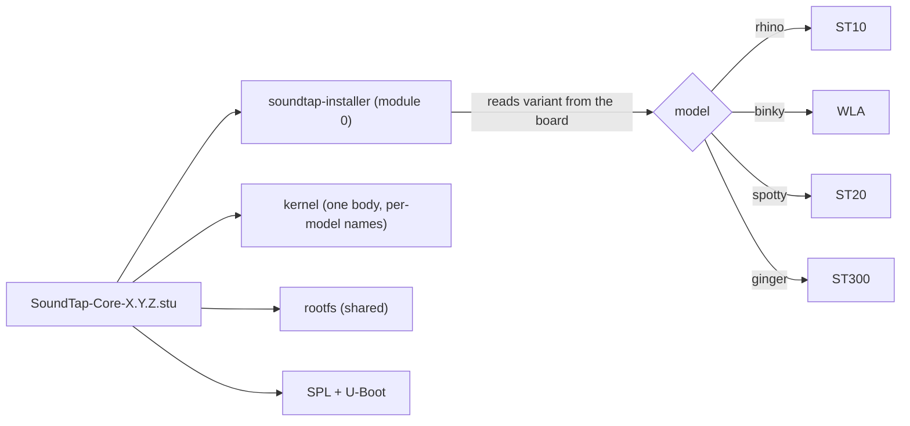

# 0008. One universal STU for every model

Status: accepted — 2026-11-21

## Context

A user should not have to know which file matches which speaker, and each extra package is
another validation path. Stock's `:17008` updater checks only the four-byte container magic,
runs module 0 as root and leaves validating the content to that installer, so whether one file
can serve every model is a question about SoundTap's installer, not about Bose.

One package for every model means that every part that installs or boots it decides the model
on the board, from the variant the board reports, and all of them must decide alike: the init
script, soundtapd's install path and hardware profile, the installer that runs on stock
firmware, U-Boot, and the STU builder and checker. A copy that drifts makes a speaker boot or
install differently depending on which route flashed it.

## Decision

### One file

A release is exactly one file, `SoundTap-Core-X.Y.Z.stu`, and it installs on the ST10, the
Wireless Link, the ST20 and the ST300. It carries SoundTap's installer as module 0, one shared rootfs,
one kernel (model-suffixed copies where the bootloader needs a name), per-model device trees,
and SoundTap's SPL and U-Boot. The same file goes through every route. A first install from stock takes,
in order of preference, the update feed (stock's updater fetches it itself), an upload to stock's
`:17008`, or a USB stick at power-on ([ADR 0130](0130-usb-stick-recovery.md) for
the stick under SoundTap's U-Boot). Every later update goes through SoundTap's own `POST /api/firmware`.

The installers that start the feed route (`install.sh`, `install.ps1` and the browser installer
in `docs/installer/`) admit a stock speaker by one table, `docs/installer/versions.json`: the
supported models, the previews and the models not supported, told apart by the `:8090/info`
type and, where it matters, module (a SoundTouch 20 reporting the Series III's `sm2` module is
the Series III preview). A model the table does not name is not supported. The installers do
not check the Bose software version: the browser installer cannot read it (the stock service
sends no CORS headers), and the oldest version with a recorded install per model is evidence of
what has worked, not a known limit. The installation guide lists those versions.

### One model table

`os/models.json` is the one table of the models. Per model: its variant, the module suffix and
boot chain it takes from the package, the model its kernel's uImage names, the stock rootfs
ceiling, and what SoundTap's U-Boot identifies it by (the manufacturing name, the recorded
`variant_raw` range). Per variant: the model it runs as, its product name and module type, the
device tree and kernel its slot loads from `/boot`, and its codec script. Names only stock
firmware reports are marked as such and get no boot files. The table records only what is
measured or built.

soundtapd's copy is generated (`os/support/models_gen.py` writes
`app/internal/modeltable/table_gen.go`), because soundtapd is built from `app/` alone; the
install path, the boot recipes and the STU reader read it. Every other copy stays in its own
language, where it runs, and `os/tests/build/test_models_table.py` holds each to the table by
running it offline: the init script's `detect_model` and `copy_codec_script`, the installer's
answers per variant, U-Boot's `rt_board_setup` compiled for the host, both post-build scripts
against a fake tree, and the Python tools' own tables. Boot-chain code is checked, never
generated: its bytes change only when the boot chain is meant to.

### The package decides what it writes

An install writes the bootloaders (mtd0-mtd4) that differ from the package and leaves the rest
alone; the caller is not asked to keep or replace them. One exception: a copy whose bytes match
but whose comparison read needed many ECC corrections is written again. The installer reads the
kernel's count of corrected bitflips for the partition (`corrected_bits`, the `ECCGETSTATS`
count) around each copy's comparison read; a rise of at least the partition's
`bitflip_threshold` rewrites that copy, in its place in the order, once per install, logged.
Code the ROM and the SPL must read is rewritten early rather than late. A copy that still needs
corrections after its rewrite is logged and left; its bytes are right. Without the kernel's
counts nothing is rewritten for them. The write order is
[ADR 0009](0009-mainline-linux-own-bootloaders.md)'s.

Alternatives that lost: per-model packages (an artifact and a test matrix per model, and users
pick the wrong one); separate bootstrap and update packages (two security contracts); reading
the JSON table at run time everywhere (BusyBox at boot, the installer on Bose's kernel and
U-Boot have no JSON parser, and soundtapd's build does not see `os/`); generating every copy of
the table (generating into U-Boot or the SPL changes boot-chain bytes, which needs a hardware
round per model, and generating into the init script makes the one file that must boot harder
to read); headers that let the caller keep or replace the bootloaders (nobody could make that
choice: the person updating a speaker cannot judge it, the package can).

## Consequences

- One CI pipeline (`build.yml`) and one release job (`release.yml`). Every change to one
  model's payload rebuilds and re-tests the package for every model.
- The model is decided on the board at install and boot time, never by the file name. The only
  borrowed thing is the `BOSE` magic stock authenticates.
- A new model or variant is one edit to `os/models.json`, then `go generate`. Generation does
  not reach the init script, the installer or U-Boot, which carry their own tables; the test
  names every copy that has to follow.
- A stock `Update.stu` goes back through the same request as an update, bootloaders included.
- An STU with a changed SPL or U-Boot writes mtd0-mtd4 on every speaker that installs it,
  without anyone being asked. A bad SPL then leaves only the mask ROM. The gate is the release:
  a build whose bootloaders changed is proven on the maintainer's own speakers before it ships (the install
  gate and the hardware layer of `docs/contributors/testing/install-gate.md`). Whoever installs a candidate
  by hand compares its SPL and U-Boot with the speaker first when the bootloader sources
  changed.
- Under stock's updater, module 0 tells stock how far it is with `SoftwareUpdateStatus`.
  Stock's state enum is idle 1, downloading 2, authenticating 3, installing 4, completed 5,
  and any other value reads as idle. The installer sends wire state 0 with 0 % before the
  stream (the first status only starts stock's update, whatever its state), stock's
  downloading with 1..89 % while the package streams in (from the bytes received against the
  size stock declared, at most every two seconds, from the first data response on), wire 3
  (stock's authenticating) with 90 % once the stream checks out, and wire 4 (stock's
  installing) with 100 % before the reboot. Those first and last wire values are the ones the
  install records proved. The recorded handshake's "a status before the first data request
  drops the link" is stock resetting on every status after the first that reads as idle, so
  nothing after the first status is ever sent as 0 or 1. Stock's display moves only for
  downloading and installing. That it shows the download progress is not yet seen on a
  speaker (stock's log line `StatusUpdated: state: downloading`); one build switch
  (`SOUNDTAP_STREAM_PROGRESS=0`, `WLA_STREAM_PROGRESS=0` in `os/installer/module/build.sh`)
  leaves only the statuses around the stream.
- How the installers write a slot that has a failing block is
  [ADR 0128](0128-bad-block-marking.md); what a first install carries over
  from stock is [ADR 0129](0129-first-install-keeps-settings.md).

## Code

- `os/installer/build-stu.py` and `os/support/stu_check.py`: build and check the universal
  package; `os/installer/module/installer.c`: module 0, which reads the variant on the board.
- `app/internal/stu/profiles.go`: the module lists (`stu.Expected`, `stu.ExpectedSoundTap`),
  `stu.ModuleForModel` and `stu.RootfsLimit`.
- `os/models.json`, `os/support/models_gen.py`, `app/internal/modeltable/table_gen.go`,
  `os/tests/build/test_models_table.py`: the model table, its generated Go copy and the test
  that runs every other copy.
- `install.ModelForVariant`, `install.VariantForModel`, `install.BootloaderModules`,
  `flash.MainlineRecipes`: the readers of the table.
- `install.BootloadersChanging` and `install.WriteBootloaders`
  (`app/internal/install/bootloaders.go`): what an install writes to mtd0-mtd4, and the
  ECC-correction rewrite.
- `docs/installer/versions.json`, `docs/installer/install.sh`, `docs/installer/install.ps1`:
  which stock speakers the feed route admits.
