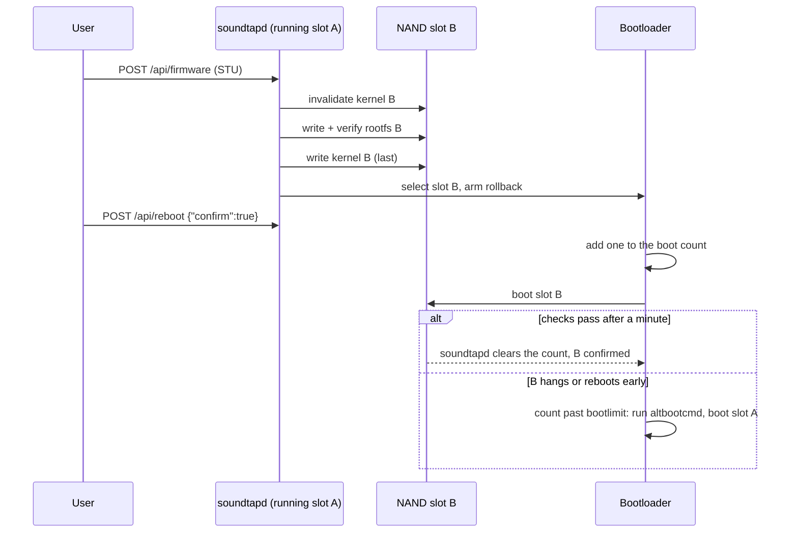

# 0010. A/B slots, boot confirmation and rollback

Status: accepted — 2026-11-20

## Context

Every model has the same NAND layout: two kernel partitions (`mtd6`/`mtd7`, Ping/Pong) and two
rootfs partitions (`mtd8`/`mtd9`). A power loss or a bad image during an update must never leave a
speaker without a bootable system.

Our U-Boot picks the slot from its environment (`bootcmd`, `altbootcmd`, the boot recipes). Bose's
U-Boot keeps one 8 KiB copy of the environment at the start of `NAND.U-Boot-Env` (mtd5, one erase
block): every write erases the only copy first, so a power cut in that window leaves U-Boot on its
built-in default, and Bose's entries plus our recipes nearly fill it. mtd5 is one erase block and
the next partition is Kernel-Ping, so a second copy cannot go there.

U-Boot can count boots: built with `CONFIG_BOOTCOUNT_LIMIT` and `CONFIG_BOOTCOUNT_AM33XX` it adds
one to a count in RTC SCRATCH2 on every boot (magic `0xB001` and the count, big-endian) and runs
`altbootcmd` instead of `bootcmd` once the count passes `bootlimit`. A cold reset or a power cut
clears SCRATCH2, so a slot that dies that way would count every boot as boot 1 and never fall back.

The project prefers popular, widely used tools where they exist. libubootenv (`fw_printenv`,
`fw_setenv`) is the standard way to edit the U-Boot environment on embedded Linux; SWUpdate and
RAUC use it, and Buildroot packages it.

## Decision

### An update writes only the inactive slot

- An update writes only the inactive kernel/rootfs pair. It never touches the running slot or
  `mtd10`-`mtd12`. The shared `mtd5` environment carries the boot recipes, the fallback and
  `bootlimit` as well as the selection; an install may repair or update those.
- Before erasing the inactive slot, an install points the environment back at the running slot if
  it selects the inactive one, with `altbootcmd` pointed away from the slot it is about to erase.
- Order: make the candidate kernel unbootable, write and verify the rootfs, write the kernel last,
  then select the slot. An install also writes the bootloaders that differ from the package
  ([ADR 0008](0008-one-universal-stu.md)).
- The rootfs is read back whole before anything makes it bootable. While the UBI image streams
  into `ubiformat`, soundtapd records a CRC-32 of each LEB's data from the image itself (the bytes
  the package CRCs and signature cover). It then attaches the written slot, reads every volume back
  as far as the image filled it, and refuses the slot on an I/O error, a short read or a LEB that
  differs. Only then does it mount the slot read-only and check the kernel, the device tree and
  `/init`. A refused slot keeps its erased kernel and is never selected. Memory stays bounded: one
  eraseblock of buffer and eight bytes per LEB. A stock rootfs (`ubi.img`) is written without the
  readback.
- The kernel is read back after `nandwrite` and compared with the staged image before the
  environment changes.
- Slot selection is `bootcmd` in the environment, on every model.

### The environment: two copies, written with libubootenv

Our U-Boot keeps a redundant environment (`CONFIG_ENV_REDUNDANT`): two copies of 32 KiB, each at
the start of its own erase block, the primary at the start of `NAND.U-Boot-Env` (flash 0x260000)
and the other in the last erase block of `NAND.U-Boot` (flash 0x240000), behind the spare U-Boot
([ADR 0009](0009-mainline-linux-own-bootloaders.md)). Each copy is a CRC32, a flag byte and the
entries; U-Boot boots the copy that checks out, and of two that do the one with the newer flag. A
save writes the other copy with the next flag, so a cut leaves the old one. `CONFIG_ENV_RANGE`
stays one erase block for both, so a bad block under either copy loses that copy, not the
environment.

- **The format follows the U-Boot.** Our U-Boot adds `soundtap.env=redundant` to every kernel
  command line; soundtapd writes the redundant format only under that marker and Bose's single
  8 KiB copy otherwise, so no U-Boot meets a format it cannot read. While neither redundant copy
  checks out, U-Boot reads the single copy (`CONFIG_ENV_REDUNDANT_UPGRADE`), and its first save
  writes the redundant one.
- **A whole environment is both copies,** written where no copy checked out (a first install, a
  conversion, a rebuild): the redundant copy first with flag 1, the primary after it with flag 2.
  soundtapd, the installer module and the recovery tools write the same bytes for the same entries.
- **Who writes which.** The first install from stock keeps Bose's single copy while Bose's U-Boot
  may still boot: it erases the redundant block, writes the recipes in the single copy, writes the
  boot chain, and only then writes both redundant copies with the slot switch. soundtapd converts
  the single copy at its next repair once the U-Boot says it reads the redundant one; under a
  U-Boot that does not, it erases a redundant copy that checks out. The way back to stock writes
  the single copy and erases the redundant one before Bose's first bootloader write, and refuses an
  environment that no longer fits 8 KiB before anything is written.
- **soundtapd writes through libubootenv.** It reads with `fw_printenv -c <config>` and writes with
  `fw_setenv -c <config> -s <script>`; the config is written per call from the partition table, in
  the format the U-Boot on the board reads. An unchanged environment is not written, and every
  write is read back and compared with the edit. A value `fw_setenv -s` cannot carry (an empty
  value, a newline, a line longer than its buffer) is refused before anything is written. The
  installer module writes the environment itself, because Bose's root filesystem has no
  `fw_setenv`.
- **A damaged environment is rebuilt, not edited.** The image ships no `/etc/u-boot-initial-env`,
  so libubootenv exits with an error instead of falling back to defaults. Before an install and at
  boot confirm, soundtapd reads the raw copies: one that checks out is enough (libubootenv writes
  the other), the single copy is converted with every entry kept, and anything else is rebuilt
  with our recipes for this model and `bootcmd` on the running slot, which just proved it boots.

### Boot confirmation and rollback through U-Boot's boot count

- **Arming.** When an install selects a slot, it writes in the same save as `bootcmd`:
  `altbootcmd` (the other slot), `bootlimit=4` and `upgrade_available=1`, and removes `bootcount`.
  soundtapd, the installer module's final write and the USB-stick recovery all do this. A stock
  install removes all of them.
- **Counting across power cuts.** While `upgrade_available` is 1, U-Boot also keeps the count in
  the environment and boots by the larger of that and SCRATCH2, saving the environment once per
  such boot up to `bootlimit + 1`; past that `altbootcmd` runs anyway, so a fallback that never
  confirms does not write NAND on every boot. A confirmed slot counts in SCRATCH2 alone, with no
  NAND write per boot, and still falls back through warm resets.
- **Confirmation.** A boot counts as good once soundtapd's HTTP service has run a minute (also on
  `-no-audio` boots) and every check holds, looked at again every 10 s for as long as soundtapd
  runs: `/api/version` answers HTTP 200 on loopback within 5 s, and on the ST20 this boot's BCO
  install step is over and `bcolink0` exists. Only our own BCO app brings up that link
  ([ADR 0031](0031-bco-network-card.md)); a slot whose BCO image does not come up rolls back, so
  that the other slot's soundtapd flashes its own image back. Nothing else is checked: not the
  network, so a speaker without a router still confirms a good image; not the audio, because what
  breaks audio (the codec script on `/mnt/nv`, the amplifier) is not fixed by the other slot, and a
  stalled mixer is the watchdog's ([ADR 0052](0052-soundtapd-lifecycle.md)). A boot that never
  passes stays unconfirmed and is not rebooted for it.
- **Settling.** The confirmation clears `upgrade_available` and `bootcount` (one environment
  write, none when they are absent), resets SCRATCH2, and brings an armed `bootlimit` that differs
  to `BootLimit`. It clears them only while `bootcmd` selects the running slot: a selection of the
  other slot is an install's that has not booted yet, and `POST /api/reboot` (which settles before
  it reboots) and a soundtapd restarted within that boot leave it armed. A count above the limit at that moment means U-Boot ran `altbootcmd`: soundtapd
  selects the slot it is running, with `altbootcmd` on that slot too, until the next install.
- **The limit is 4.** A trial boot on the ST20 that installs a new BCO image waits for its flash
  (cut off after 15 minutes) before it confirms, long enough for a household to pull the plug more
  than once. With 4, three cuts in a row, each before its boot's confirm, leave a fourth boot of
  the new slot to confirm it.
- **The first BCO install** over Bose's app reboots the ST20 to start its network; that reboot
  waits up to 2 minutes for the confirmation, so it does not count against the slot.
- **Init's part.** On a NAND boot whose count is at most `2 * bootlimit + 1` (both slots tried),
  init arms its boot watchdog for 300 s; only soundtapd answering disarms it, so a router outage is
  not a reboot loop, and past that count the speaker stays up so the failure can be looked at.
  Until the confirm, init sets the reboot mode to warm once, right after mounting `/proc`, `/sys`
  and `/dev`, so a reboot or panic from Linux keeps SCRATCH2; soundtapd puts cold back at the
  confirm.

Alternatives that lost: full-NAND flash per update (no fallback; it bricked an ST10); keeping our
own environment writer (it worked, but it is our code doing what a standard tool does); linking
libubootenv through cgo (soundtapd is a static Go binary built without cgo); a try flag in the
environment read by our own `bootcmd` (our own logic where U-Boot's boot count already does the
job); `CONFIG_BOOTCOUNT_ENV` alone (it is the same Kconfig choice as the RTC backend, so a
confirmed slot would lose its warm-reset fallback); a boot guard in our SPL (one boot chain for
every model replaces it); a limit of 3 (three power cuts during a long ST20 trial boot rolled a
good update back).

## Consequences

- An install that does not boot, or a userspace that never brings soundtapd up, costs at most five
  boots (about 25 minutes) and lands on the previous slot, which is then selected. A slot that
  boots but misbehaves later needs a manual reinstall or slot switch, and there is only one
  previous version to fall back to.
- A good update is confirmed a minute after soundtapd starts (up to 10 s later); on the ST20 a
  trial boot that flashes a new BCO image confirms after the flash. Power cuts roll a good update
  back only when four in a row each land before their boot's confirm; five quick reboots in the
  first minute of a new slot do the same. That is the standard U-Boot trade-off.
- A power cut during any environment write leaves a copy U-Boot boots: the old one. Every
  environment write erases one block of mtd4 or mtd5, alternately; at most `bootlimit + 1` saves
  per install come from the boot count.
- A downgrade to a SoundTap build whose U-Boot reads only the single copy boots U-Boot's built-in
  default (both slots, Pong first), and that build's soundtapd rebuilds the single copy at its boot
  confirm.
- The first install from stock (`:17008`) has no A/B safety on stock's side; it relies on stock's
  own recovery.
- `fw_printenv` works over SSH for diagnosis, given the same `-c` line.
- Hardware proof: the rollback and power-cut rows of the release checklist and the boot-confirm
  rows in [`docs/hardware/hardware-test.md`](../hardware/hardware-test.md#release-checklist-per-model); earlier runs
  are recorded in [`docs/hardware/install-records.md`](../hardware/install-records.md#route-notes). The conversion
  of an installed single copy, a save under a bad block and the way back to stock with its single
  copy have no hardware run.

## Code

- `app/internal/flash/flash.go`: `EraseAlternateKernel`, `StartRootfs`, `WriteKernel`,
  `VerifyRootfs`, `EnvRedundantMarker`; `app/internal/flash/rootfs_digest.go`: the per-LEB
  readback.
- `app/internal/flash/bootselect.go`: `HoldRunningSlot`, `SelectSlot`, `armRollback`, `BootLimit`,
  `RepairEnv`, `UseLegacyEnv`, `ConfirmPendingBoot`, and the `fw_setenv` path (`rewriteEnv`,
  `envConfig`); `app/internal/flash/bootcount.go:ConfirmBootCount`: SCRATCH2.
- `app/internal/ubootenv/ubootenv.go`: the codecs of both formats; `app/internal/ubootenv/ubootenvtest`
  and `app/internal/ubootenv/writers_test.go`: the fakes and the same-bytes check of every writer.
- `app/cmd/soundtapd/bootconfirm.go`: `confirmBoot`, `bootConfirmAfter`, `bootConfirmPoll`;
  `app/cmd/soundtapd/bco_install.go`: `bcoFlashLimit`.
- `os/bootloader/uboot/uboot-2026.07-env-redundant.patch`,
  `os/bootloader/uboot/uboot-2026.07-bootcount-env.patch`,
  `os/package/soundtap-bootloaders/configs/wla-uboot.config`: the U-Boot side.
- `os/installer/module/installer.c`: the first install's environment writes.
- `os/support/uboot_env.py`: the offline writer of `uboot_recipes.py` and the stock-route dry run.
- `os/overlay/etc/init.d/soundtap`: `set_reboot_mode` and `start_boot_watchdog`.
- `os/support/rootfs_check.py`: no `/etc/u-boot-initial-env` in the image.
- `os/tests/boot/test_uboot_bootcount_env.py`, `os/tests/boot/test_reboot_mode.py`: the boot
  count through cold and warm resets, and the reboot mode, on the host.
