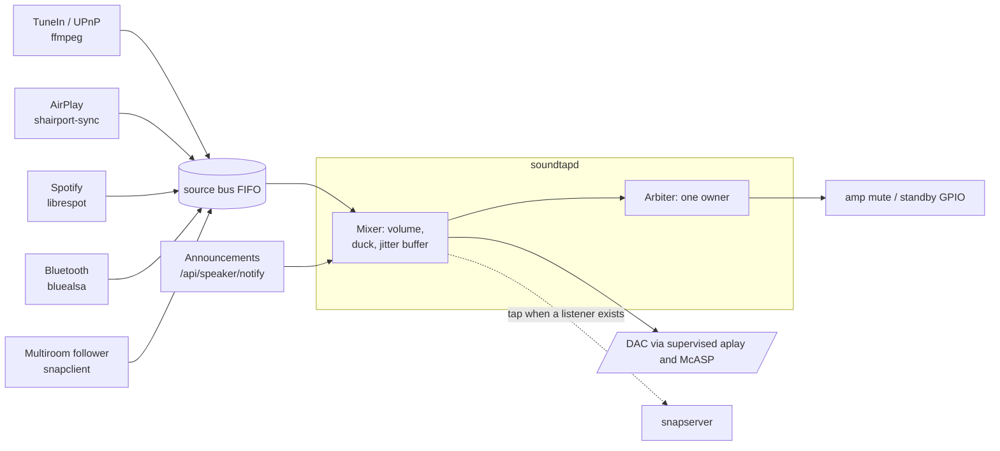

# 0012. soundtapd is the only writer to the DAC

Status: accepted — 2026-11-04

## Context

The speaker's physical sink is exclusive. Several sources want it: TuneIn and UPnP
(soundtapd's own ffmpeg), AirPlay (shairport-sync), Spotify (librespot), Bluetooth (bluealsa)
and a multiroom follower (snapclient). When each daemon opens the device itself, the second
gets `Device or resource busy`, nothing can duck a source for an announcement, and no one
volume curve applies to all of them.

On the ST10 and ST20 the AIC3256 codec is set up by a stock script (`rhino_sm2_normal.cfg`,
`spotty_scm_normal.cfg`). A few dozen of its roughly ten thousand writes configure the codec;
the rest is Bose's miniDSP program, coefficients and speaker tuning. Without that program the
speaker sounds different, and the sound must stay exactly as on stock. The script is Bose's,
so neither the repository nor an image may carry it ([ADR 0049](0049-no-stock-bytes.md)).
Every speaker that runs SoundTap was installed from a slot that holds it in `/lib/firmware`:
stock's rootfs after the STU install, or the previous SoundTap image after an update.

Stock applies the master volume in the codec's DSP, not in the PCM: APServer writes two words
per step into the page 0x2C register 0x10 block, the gain in Q22 (unity `0x400000`) and the
same level in dB times 65536 (`0` at unity), from two 101-entry tables. Applying
the master volume in the PCM instead makes a step audible only after the sink buffer, and at
the lowest steps hands the codec a signal near the bottom of its word
([ST20 observations](../hardware/st20/hardware-contract.md#observations-behind-audio-choices),
[ST10 stock audio path](../hardware/st10/stock-audio-path.md)).

## Decision

### One writer: soundtapd's Mixer

Every source rendered on the AM335x writes raw S16_LE 48 kHz stereo PCM into one source bus, a
FIFO under `/run/soundtap`, through the ALSA `busfile` plugin (`os/overlay/etc/asound.conf.bus`).
soundtapd's Mixer owns the physical sink through its supervised `aplay`, at the format and rate
the model's card takes; source daemons never open the card. The Mixer paces itself one 20 ms
block at a time against the wall clock, because the DAC does not push back. The Arbiter tracks
the one source that owns the speaker and preempts the previous owner's daemon. Volume,
announcement ducking, amp mute and amp standby happen in this one place.

The ST300's TV/HDMI audio is the exception: its soundbar processor plays it directly, and
multiroom captures the processor's return without routing the local TV through the Mixer
([ADR 0116](0116-st300-tv-input-share.md), [ADR 0109](0109-st300-soundbar-processor-link.md)).

### The codec script comes from the speaker itself

On the ST10 and ST20 the init script copies the speaker's own script from the other slot into
`/mnt/nv/soundtap/codec/` when it is not there yet: it attaches that slot read-only, copies
`/lib/firmware/<name>` and detaches. `aic3256-loader` and `aic3256-bitbang` read the script from
there, so the codec gets exactly stock's register writes. The backup file carries the script
and a restore writes it back when the speaker has none (only the one this board loads,
`<variant>_<module_type>_normal.cfg`). While the script is only in the other slot, init writes
`/run/soundtap/codec-only-in-other-slot` and soundtapd refuses a SoundTap package over that slot;
Bose's package carries the script and stays allowed.

### The master volume lives in the codec DSP, as on stock

Where the codec tool takes a coefficient (`aic3256-loader --volume[-blind] HEX48`,
`aic3256-bitbang --volume HEX48`), soundtapd moves the master volume into the DSP once the
full-scale pass has succeeded:

- `SetVolume` hands the gain to the codec at once; a worker runs the tool and the newest value
  wins. The PCM then reaches the codec at full scale.
- Word 0 is `stockVolumeGain` (our own fit to stock's curve) in Q22, word 1 its level in dB
  times 65536. No table is copied from Bose. Sending the gain as one 48-bit number instead put
  noise in word 1 that changed with every step, and the bass with it (ST20, 2026-11-23).
- The PCM keeps what is relative: the duck, the hold gate, and an announcement against the
  source. An announcement louder than the listening volume turns the codec up to its level and
  the source down by the same ratio in the PCM, timed to the moment the block reaches the DAC,
  so both halves land together.
- A write ends in the codec's coefficient flip, which needs the DAC clock; an ALSA underrun
  stops it for a moment. A failed write therefore waits for the clock and is tried again
  (the first write up to six times, a later one three times) before the volume leaves the
  codec: in the PCM the lowest steps crackle. If the first write still fails, the volume
  stays in the PCM; if a later one does, the volume moves back into the PCM on top of the
  codec's last level. Neither failure makes the speaker louder than asked.

The WLA has no AIC3256 and keeps the volume in the PCM.

Alternatives that lost:

- **dmix or PulseAudio.** More RAM and CPU than the 128 MiB boards can spare, and no clean hook
  for source ownership.
- **Each daemon on the device in turn.** No mixing, no ducking, and races on handover.
- **Our own codec configuration without the miniDSP.** It changes the sound.
- **Our own configuration with Bose's EQ rebuilt in the Mixer.** Close but not bit-exact, and
  still Bose's tuning in another form.
- **Copying the script from stock in the C installer.** It covers only the STU route; the boot
  copy covers the STU route and updates from images that still carry the script.

## Consequences

- External daemons are configured to output to the bus, never to `hw:`.
- A Mixer stall can affect every source. Startup prebuffering is 2 s by default and 6 s on the
  ST20; live sources use smaller targets (80 ms for a Snapcast follower, 60 ms for AUX). The
  Mixer must stay cheap on a single-core Cortex-A8 ([ADR 0001](0001-soundtapd-one-go-daemon.md)).
- The ST300 processor owns its local TV path and its volume protocol; the Mixer does not duck
  TV audio inside that processor.
- No Bose program or tuning is in the repository or in any image we build or publish. The
  persistent volume and the owner's backup file hold the speaker's own copy; factory reset
  keeps it, because the reset removes only named files.
- A speaker whose persistent volume lost the script, and whose other slot has none, stays muted
  with a logged error. The way back is a backup file exported while it still had the script
  (`GET /api/backup`, restored with `POST /api/restore`; the web UI has no backup button),
  or a reinstall from stock (a production image has no shell to copy it by hand). The USB-stick
  recovery does not check the other-slot marker.
- A volume step costs one codec write, about 34 register writes plus the buffer flip. Over the
  ST20's GPIO bit-bang that takes tens of milliseconds; because the newest value wins, a held key
  never queues writes.
- A DSP coefficient change is a step, like stock's; the master volume has no PCM glide. Bass has
  no audio stage of its own, as on stock.

## Code

- `os/overlay/etc/asound.conf.bus`: the source bus every daemon writes to.
- `app/internal/audio`: the Mixer (`audio.Mixer`, pacing in `app/internal/audio/pace.go`), the
  Arbiter (`audio.Arbiter`), the volume curve `app/internal/audio/volume.go:stockVolumeGain` and
  the codec volume hand-off `audio.Mixer.SetCodecVolume` (`app/internal/audio/codec_volume.go`).
- `app/cmd/soundtapd/audio_sink.go`: the supervised `aplay` and the sink format per model.
- `app/cmd/soundtapd/codec_gain.go`: the full-scale pass (`applyCodecGain`) and the DSP volume
  worker (`newCodecVolume`, `codecGainHex`); `app/cmd/soundtapd/latency.go:afterMixer` times a
  codec change to the DAC.
- `os/overlay/etc/init.d/soundtap`: `codec_script_from_other_slot` and the codec load.
- `os/drivers/aic3256-loader.c`, `os/drivers/aic3256-bitbang.c`: the codec tools.
- `app/internal/web/firmware/firmware_install.go:codecOnlyInOtherSlot`: the refusal while the
  script is only in the other slot; `app/internal/web/backup_codec.go`: the script in the backup.
