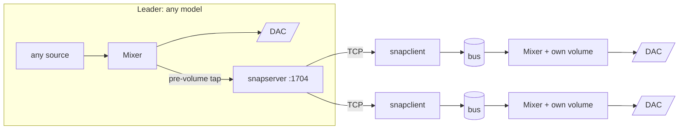

# 0013. Multiroom through Snapcast

Status: accepted — 2026-10-21

## Context

Bose's updated app retains local grouping after the cloud shutdown
([Bose's announcement](https://www.bose.com/soundtouch-end-of-life-row)). SoundTap replaces that
firmware and needs its own way to play one source on several speakers in step. The speakers are
on one LAN; under our BCO app the ST20's main CPU has its own `wlan0` address there, as an ST10
does ([ADR 0031](0031-bco-network-card.md)). Any source must be groupable, not only Apple's,
and soundtapd stays the only writer to the DAC
([ADR 0012](0012-single-dac-writer.md)). Measurements behind the choices below are in the
[hardware test](../hardware/hardware-test.md#multiroom-measurements).

## Decision

Multiroom is Snapcast: one speaker leads, the others follow its stream.

### The stream

Every speaker runs `snapserver`. The leader taps its mix *before* volume into snapserver, only
while a listener exists; each follower applies its own volume. A `snapclient` runs only when
there is a group to serve:

- on a follower while its source is MULTIROOM, pointed at the leader's `tcp://<leader>:1704`,
  writing into the source bus, so the follower's Mixer still owns the DAC;
- on a leader as a silent, muted anchor on `127.0.0.1:1704` rendered into `/dev/null`, which
  holds the leader's Snapcast group. The anchor starts at an invite, at a membership change and
  whenever another client is connected, and stops one minute (`AnchorHold`) after the last of
  these; a membership change waits up to 5 s for snapserver to know the anchor. It runs at
  `nice 19` so it does not take the CPU a Spotify leader needs at a track start.

In plain standby, and on a follower in its group's standby, no snapclient runs. Every model,
the ST20 included, may lead; nothing in soundtapd, the init script or the web app treats a model
differently here.

Discovery is mDNS and `/api/devices` ([ADR 0043](0043-mdns-through-avahi.md)), not Snapcast's
own: snapserver announces nothing (`mdns_enabled = false`), because its Avahi client polls every
50 ms on an idle speaker. A third-party snapclient connects by the speaker's address.

### Groups are one hop deep

Grouping (`POST /api/multiroom/invite` on the leader) points a follower's snapclient at the
leader and writes that choice to `/mnt/nv/soundtap/multiroom-server`, so it survives a reboot.
A speaker with another speaker connected to its snapserver refuses
`POST /api/multiroom/follow` with a host (409); leaving is always allowed. A speaker that
follows another and is asked to invite a third passes its own leader's address, so the third
joins the root leader directly. A group is therefore always one leader plus followers: a chain
would stack a snapserver buffer per hop, and a loop plays nothing.

### A follower tracks its leader by device id

The follow request carries the leader's device id as well as its address
(`{"host": ..., "id": ...}`, sent by the invite), stored as the second line of
`multiroom-server` under the address, so one write changes both. The follower dials the leader's
port 1704 every 30 s. When it does not answer, the device registry is asked for the address that
id has now ([ADR 0043](0043-mdns-through-avahi.md)); a leader found there and answering is
followed at the new address. After ten failed checks in a row (five minutes) the follower leaves
the group: the file is removed and the source goes to STANDBY. A follow without an id still
works and only gets the give-up.

### Sync from each speaker's measured audio chain

Snapcast puts a chunk on every client's output at the same moment, but a follower's output is
the source bus, not the DAC, and the leader does not play through Snapcast at all. So every
speaker measures its own chain twice a second and averages over 5 s:

- **sink**: aplay's stdin pipe (FIONREAD) plus the ALSA ring (`delay` in
  `/proc/asound/card0/pcm0p/sub0/status`, at the rate in `hw_params`);
- **upstream**: the bus FIFO plus the Mixer's queued blocks;
- **backlog** (leader only): the snapserver tap's FIFO.

A follower reports `upstream + sink` at `GET /api/multiroom/downstream` (`{"ms": N}`, peer
addresses only). The leader sets that as the client's Snapcast latency (10 ms steps) and delays
its own output by `1000 ms (Snapcast buffer) + backlog − sink`, in 20 ms Mixer blocks, moving it
only when the target is two blocks or more away, because each move drops or repeats PCM. The
Snapcast buffer is 1000 ms, Snapcast's own default: what is left after a follower's latency is
all its Wi-Fi headroom. A follower's source is already paced by snapclient, so its Mixer uses
the short refill target instead of the full prebuffer while the source is MULTIROOM.

Alternatives that lost: AirPlay 2 multiroom only (Apple-only, and not for Spotify or TuneIn); a
custom RTP stream (Snapcast already solves clock sync and buffering); resolving chains at play
time (keeps the buffers stacked, and every speaker must know the tree); following
`<slug>.local` (snapclient and BusyBox resolve no mDNS names on the speaker, and avahi renames on
conflict); retrying a lost leader forever (a silent speaker on MULTIROOM looks broken);
per-model fixed sync offsets (they break whenever a buffer size changes and miss a follower that
just re-prebuffered); followers playing through snapclient's ALSA player (a second DAC writer,
against ADR 0012); a larger Snapcast buffer (every play and group change would start later).

## Consequences

- The ST20 depends on our BCO app for this, as for everything else on the network.
- The leader does the source work and the snapserver encode for the whole group.
- An idle speaker in standby runs no snapclient. A leader's anchor is not on the audio path:
  snapserver keeps its client record, and so its group, while it is disconnected.
- nqptp keeps running whenever AirPlay 2 can: shairport-sync registers with it once, at its own
  start, so nqptp cannot be started on a session's first request.
- Regrouping a leader under another speaker takes two steps: ungroup, then follow. A leader
  switched off for more than five minutes ends the group; its followers do not rejoin by
  themselves.
- The group stays in step across models without per-model constants. Up to about 20 ms of
  residual offset remains, and a follower chain longer than the 1000 ms buffer cannot be
  corrected, so every follower-side buffer must stay well below it.
- Speakers expose a peer-only route, `/api/multiroom/downstream`, carrying one number and no
  audio.
- A stereo pair is a group of two ([ADR 0107](0107-stereo-pair-acts-as-one-speaker.md)).

## Code

- `app/internal/multiroom`: the group: `multiroom.Group` (`Join`, `LeaveFollow`, `CheckLeader`),
  the follow file (`multiroom.ReadFollow`, `multiroom.WriteFollow`), `multiroom.ErrChained`,
  the anchor (`multiroom.AnchorHold`, `multiroom.AnchorDemand`) and `multiroom.SyncLatencies`.
- `app/internal/web/multiroom_invite.go:postMultiroomInvite`,
  `app/internal/web/multiroom_follow.go:postMultiroomFollow` and
  `app/internal/web/multiroom_follow.go:followRefusal`: invite, follow and the one-hop rule.
- `app/internal/web/multiroom_leader.go:WatchLeader`: the 30 s leader check.
- `app/internal/web/multiroom_latency.go:getMultiroomDownstream`: the follower's chain report.
- `app/cmd/soundtapd/latency.go`: `runChainMeter` and `leaderDelayBlocks`.
- `app/cmd/soundtapd/procs.go:snapclientArgs`: follower and anchor command lines.
- `app/internal/snapcast`: the snapserver control client.
- `os/overlay/etc/snapserver.conf`: no mDNS announcement, the 1000 ms buffer.
