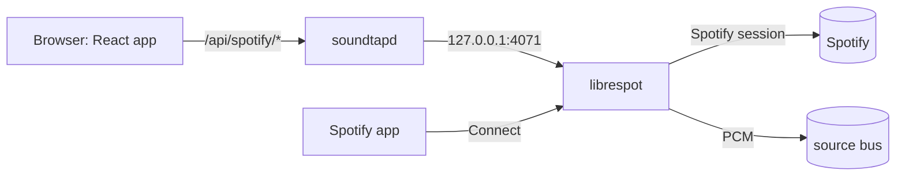

# 0014. Spotify through the librespot session

Status: accepted — 2026-11-15

## Context

Spotify Connect runs through librespot. Browsing, search and presets in the SoundTap app need
Spotify metadata and a way to start playback. The public Web API refuses librespot's shared
client identity (HTTP 429), and a developer app would make every owner create a client id and
log in with OAuth. Spotify credentials must never reach the browser, logs, backups or debug
output.

## Decision

### The session is the only route to Spotify

- librespot is patched to serve a control API on loopback only (`127.0.0.1:4071`): status,
  playback control, and requests over the session it already holds (spclient, mercury).
- soundtapd is the only client of that API and serves `/api/spotify/*` to the web UI.
- Credentials stay in librespot's own store, `/mnt/nv/spotify/system/credentials.json`, mode
  0600. They never go to the browser, logs, debug endpoints, telemetry or support bundles.
- The owner never enters a Spotify username, password, client id, secret or token: pairing
  happens with Spotify Connect from the Spotify app.
- A network failure never deletes stored credentials; only an explicit "forget" does.

### A track skip closes the sink before SoundTap flushes

librespot's ALSA backend keeps a partial period across gapless loads, so clearing only
SoundTap's queue on `loading` or `track_changed` (hooks on librespot's event thread) leaves old
PCM that can arrive with the new track. librespot therefore runs upstream's
`--disable-gapless --emit-sink-events`, with no further patch for this. Its
`sink temporarily_closed` callback runs on the player thread after ALSA has written and drained
its pending period, before the next track writes; the hook posts `flush_wait` to soundtapd's
loopback source API. The Mixer wakes its idle FIFO reader, discards the old bytes and
acknowledges before replying, so new PCM is admitted without a delayed drain eating its start.

The event-thread hook on `play_request_id_changed` classifies the boundary as `natural` or
`skip` from the preceding `end_of_track`; the sink hook waits up to one second for that answer.
A natural advance keeps its tail; a missing answer flushes. Reclaiming the source on
`sink running` does not flush again.

### A Spotify preset stores a Spotify URI and nothing else

A Spotify preset is `source="SPOTIFY" type="uri" location="spotify:<kind>:<id>"` (or
`spotify:collection` for Liked Songs), with a display name and artwork path.
`PUT /api/presets/{slot}` accepts it when `spotify.ParseURI` does. A preset key does not switch
the source itself: `speakerstate` hands the URI to its `OnSpotifyPreset` hook and soundtapd calls
`spotify.Client.Play` (a track as `uri`, anything else as `context`). librespot claims the
SPOTIFY source once audio starts, as when the Spotify page plays something. The physical key and
the IR remote do not go through the web layer, which is why playback starts from the hook.

Alternatives that lost:

- **The Web API with a developer app and OAuth.** More features, but it asks the owner for
  credentials and depends on a quota we do not own.
- **Another librespot player patch, or a replacement Spotify implementation, for the skip.**
  An upgrade burden the project declined. Snapcast's librespot adapter avoids the ALSA period
  with the pipe backend but needs a 44.1 kHz ingest path; go-librespot drops the old output
  before changing source, which is the ordering we take through upstream's sink hooks.
- **A Spotify URI under the TUNEIN source.** It breaks every consumer that treats a TuneIn
  location as a station id.
- **Starting preset playback in the web handler.** The keypad and the remote would not work.

## Consequences

- Features are limited to what the session can reach. The server search route tries mercury and
  can be refused; the UI opens Spotify's own search instead of promising catalogue search.
- Our librespot carries patches (control API, volume follow and more), so it is built from a
  pinned version and the patches are rebased on every upgrade.
- Natural track tails are complete, but gapless albums are not promised: upstream ALSA pads the
  last period when closing. Audio already handed to the DAC or Snapcast keeps its bounded
  downstream latency, so a skip is not instant silence. A failed acknowledgement is logged;
  upstream does not pass hook exit codes to playback.
- Presets, backups and restore stay credential-free: a URI is public. A preset press while
  Spotify is not connected logs a warning and leaves the speaker as it was.
- Spotify's "radio" (`spotify:station:…`) is not a URI its clients still expose; the UI offers
  the artist context instead.
- Holding a preset key stores the current Spotify URI only when `speakerstate` knows one; a
  phone's Connect session does not always tell SoundTap its playlist or album.
- The cloud-emulation mirror carries only TuneIn presets, so Spotify presets are not mirrored.
- Hardware validation is the **Spotify** row of [the hardware checklist](../hardware/hardware-test.md),
  on each model and in multiroom; offline tests cover ordering and samples only.

## Code

- `os/package/soundtap-librespot`: the pinned librespot and its patches (control API in
  `os/package/soundtap-librespot/0003-soundtap-control-api.patch`).
- `app/internal/spotify`: the client of the control API (`spotify.CtlAddr`, `spotify.Client.Play`,
  `spotify.ParseURI`).
- `app/cmd/soundtapd/procs.go`: librespot's environment, with `SOUNDTAP_SPOTIFY_BOUNDARY=1`.
- `os/overlay/opt/soundtap/spotify-source.sh`: the sink-event hook that posts `flush_wait`;
  `web.Server.setSource` (`app/internal/web/sources.go`) answers it.
- `speakerstate.Speaker.OnSpotifyPreset` and
  `app/cmd/soundtapd/spotify_preset.go:wireSpotifyPresets`: a preset key starts playback.
